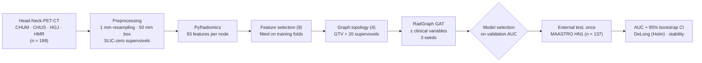
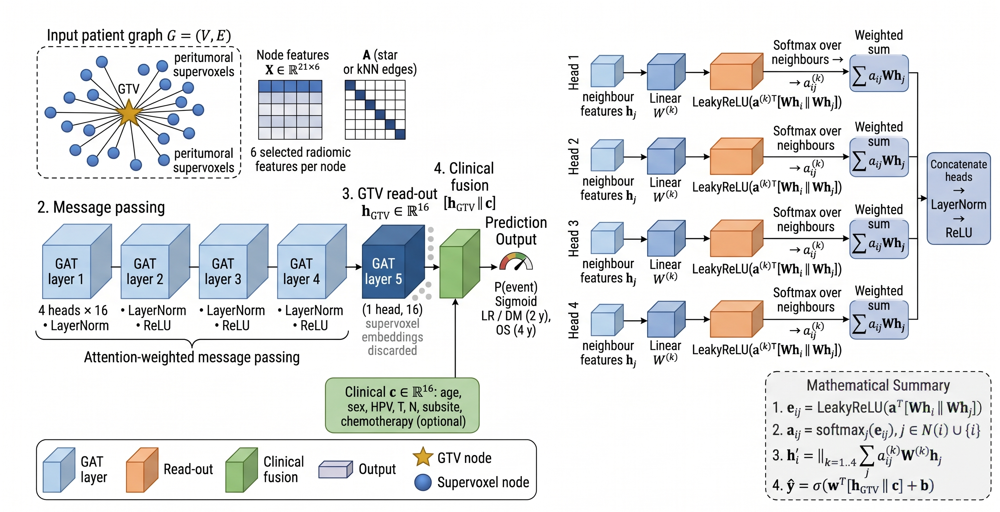
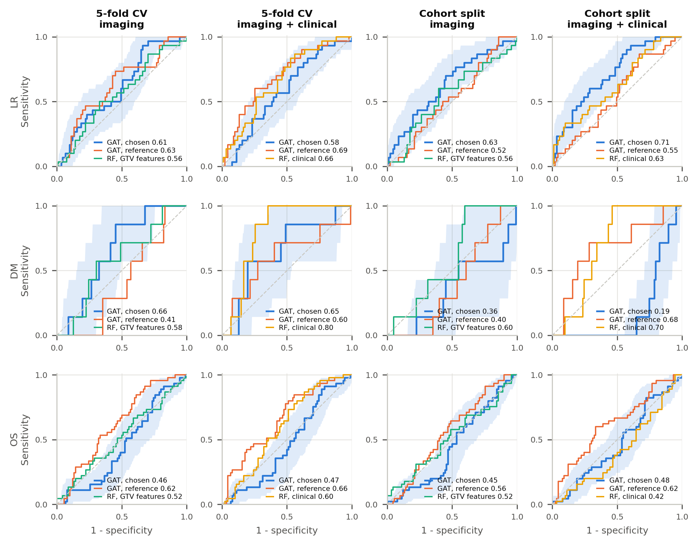

<div align="center">

# Radiomic Graph Attention Network for Head and Neck Cancer

**Reproducibility and external validity of graph-based feature selection in radiomic graph attention networks for outcome prediction in head and neck cancer**

[](https://www.python.org/)
[](https://pytorch.org/)
[](https://pytorch-geometric.readthedocs.io/)
[](https://pyradiomics.readthedocs.io/)
[](#reporting-and-reproducibility)
[](LICENSE)
[](#citation)

QIRAIL Lab · Department of Radiation Oncology · Christian Medical College (CMC) Vellore, India

</div>

---

## Contents

1. [Overview](#overview)
2. [Highlights](#highlights)
3. [Study design](#study-design)
4. [Model architecture](#model-architecture)
5. [Methods in brief](#methods-in-brief)
6. [Main results](#main-results)
7. [Repository structure](#repository-structure)
8. [Installation](#installation)
9. [Data](#data)
10. [Reproducing the study](#reproducing-the-study)
11. [Inference on new patients](#inference-on-new-patients)
12. [Outputs](#outputs)
13. [Reporting and reproducibility](#reporting-and-reproducibility)
14. [Limitations](#limitations)
15. [Citation](#citation)
16. [Acknowledgements and references](#acknowledgements-and-references)
17. [Keywords and topics](#keywords-and-topics)
18. [License](#license)

---

## Overview

A **spatial radiomic graph** represents a tumour and its surroundings as a graph. The primary gross tumour volume (GTV) is the central node and the peritumoral tissue is split into supervoxel nodes. Each node carries radiomic features, and a **graph attention network (GAT)** predicts outcome after radiotherapy for head and neck squamous cell carcinoma (HNSCC). This idea was introduced as *RadGraph* (Bae et al., 2025).

Two design choices in such models had not been tested systematically:

* **which radiomic features** describe the nodes (feature selection), and
* **how the nodes are connected** (graph topology).

The **reproducibility** of the selected features had not been tested either.

This repository benchmarks **9 feature-selection strategies × 4 graph topologies × 2 input sets** (imaging, imaging + clinical) for three endpoints:

| Endpoint | Definition |
|---|---|
| **LR**: locoregional recurrence | event within 2 years |
| **DM**: distant metastasis | event within 2 years |
| **OS**: overall survival | death from any cause within 4 years |

Models were developed on four Canadian centres (Head-Neck-PET-CT, TCIA) and tested **once** on a fully external Dutch cohort (MAASTRO HN1, TCIA). The validation design is the one used by Mateus et al. (2023), whose convolutional neural network gives a published benchmark on the same external cohort.

> **Research question.** Which feature-selection strategy gives node features that are both *predictive* and *reproducible* across centres when used in a spatial radiomic GAT, and does the graph topology matter?

## Highlights

* **Graph-based feature selection (Graph-FS)** gave the most reproducible feature sets. Spectral Graph-FS reached a Kuncheva index across CV folds of **0.64–0.73**, against **0.11–0.34 for LASSO**. It was the most stable method across CV folds, bootstrap resamples and centres.
* **Locoregional recurrence:** the GAT chosen on validation reached an external AUC of **0.71 [95% CI 0.62–0.81]** with imaging + clinical inputs in the cohort-split design. A published CNN reached **0.59** on the same cohort.
* After Holm correction, **no configuration was significantly better** than the published RadGraph reference configuration.
* **DM and OS** were not predicted better than chance by the configurations chosen on validation. The external test set had only 7 DM events.
* Feature-selection stability was **not associated** with external discrimination. **Validation AUC did not predict external AUC** (Spearman ρ from −0.40 to 0.20).
* The study is **leakage-free**: every data-dependent step is fitted on training patients only, the configuration is chosen on validation data, and the external cohort is used once.
* **Saved, self-contained model checkpoints.** Re-applying them reproduces the reported external predictions to within 10⁻⁷.

## Study design

<p align="center">
  
</p>



Two development designs, both following Mateus et al. (2023):

| Design (`--mode`) | Training / validation (Head-Neck-PET-CT) | External test |
|---|---|---|
| `MATEUS_CV` (primary) | 5-fold CV stratified by outcome; the whole pipeline is refitted in every fold | MAASTRO; predictions averaged over the 5 fold models |
| `MATEUS_COHORT` | centre split (Diamant et al., 2019): train **HGJ + CHUS**, validate **HMR + CHUM** | MAASTRO |

## Model architecture

<p align="center">
  
</p>

**Left:** each patient is a graph with the GTV (star) and 20 peritumoral supervoxels. Every node is described by the selected radiomic features and connected by star or kNN edges. GAT layers perform attention-weighted message passing. The embedding of the GTV node is read out, optionally joined with 16 encoded clinical variables, and passed through a linear layer and a sigmoid to give the event probability.
**Right:** multi-head graph attention at the GTV node.

| Hyper-parameter | LR / OS | DM |
|---|---|---|
| GAT layers | 4 multi-head + 1 single-head output layer | 3 |
| Heads × units per head | 4 × 16 | 4 × 8 |
| Normalisation / activation | graph-wise LayerNorm + ReLU | graph-wise LayerNorm + ReLU |
| Read-out | GTV node embedding (16-d) → dropout → [⊕ clinical] → linear → sigmoid | same, stronger dropout |
| Trainable parameters (with clinical inputs) | 15,057 | 1,841 |
| Loss / sampling | BCE, per-epoch class resampling to the mean class size | BCE, minority oversampling |
| Optimiser | Adam + linear warm-up, ReduceLROnPlateau, gradient clipping, early stopping (patience 50) | same |
| Checkpoint | lowest validation loss (RadGraph); Mateus AUC-gap rule as a sensitivity analysis | same |

The hyper-parameters follow the RadGraph settings for each endpoint. RadGraph specified no OS model, so OS uses the LR settings.

<p align="center">
  
  <br><em>The four graph topologies: (a) radiomic star (RadGraph), (b) spatial star, (c) radiomic kNN, (d) spatial kNN.</em>
</p>

## Methods in brief

### Image preprocessing and radiomics
* CT resampled to **1 mm isotropic** voxels (linear interpolation); GTV mask resampled with nearest neighbour.
* Crop to a box extending **50 mm** beyond the GTV. GTV voxels are removed, intensities normalised, and the region is split into **~100 SLIC-zero supervoxels** (supervoxels with fewer than 8 voxels are discarded).
* **93 PyRadiomics features** for the GTV and every supervoxel, with a bin width of 25 HU: 18 first-order, 24 GLCM, 16 GLRLM, 16 GLSZM, 14 GLDM and 5 NGTDM. Shape features are excluded.

### Feature selection (9 strategies, *k* = 6 features)

| Strategy | Type | Description |
|---|---|---|
| `table_s3` | reference | fixed RadGraph feature set (Table S3; LR and DM only) |
| `all` | reference | all 93 features, no selection |
| `mrmr` | supervised | minimum redundancy, maximum relevance (ANOVA F / mean \|r\|); OS reference |
| `lasso` | supervised | L1 logistic regression, ranked along the regularisation path |
| `boruta` | supervised | random-forest importance against shadow features |
| `rfe_rf` | supervised | recursive feature elimination with a random forest |
| `graph_fs_cc` | label-free | Graph-FS: highest-degree representative per connected component |
| `graph_fs_spectral` | label-free | Graph-FS: spectral clustering of the feature graph, feature closest to each centroid |
| `graph_fs_hybrid` | hybrid (new) | spectral communities of the feature graph; the most outcome-relevant feature of each, top *k* kept |

<p align="center">
  
  <br><em>Graph-FS: feature matrix → correlation → threshold (mean + 0.3 SD) → feature graph → spectral / hybrid representatives.</em>
</p>

### Graph topologies (GTV + 20 supervoxels)

| Topology | Edges |
|---|---|
| `radiomic_star` (RadGraph) | GTV ↔ the 20 supervoxels closest to it in **feature space** |
| `spatial_star` | GTV ↔ the 20 supervoxels closest to its centroid in **physical space** |
| `radiomic_knn` | radiomic star + 4-NN edges between all nodes in feature space |
| `spatial_knn` | spatial star + 4-NN edges between all nodes in physical space |

### Comparators and statistics
* **Random forest** on the same selected GTV features, which isolates the contribution of the peritumoral graph. **Clinical-only random forest** on the same clinical variables.
* **AUC** with 95% percentile bootstrap CI (1000 resamples). Paired **DeLong** tests against the reference configuration and against the RF, with **Holm** correction.
* **Selection stability**: Kuncheva index, Jaccard and Kendall's W, measured across CV folds, across 30 bootstrap resamples per fold, and between centres (CHUS vs HGJ).

## Main results

### Cohorts

| | Head-Neck-PET-CT (training / validation) | MAASTRO HN1 (external test) |
|---|---|---|
| Patients with CT and GTV | 199 | 137 |
| Age, median (IQR), y | 63 (57–70) | 61 (56–67) |
| Male sex | 147 (74%) | 111 (81%) |
| HPV positive / negative / unknown | 74 / 19 / 106 | 23 / 58 / 56 |
| Oropharynx / larynx | 199 / 0 | 88 / 49 |
| Concurrent chemotherapy | 173 (87%) | 37 (27%) |
| **LR**, patients (events) | 190 (13, 6.8%) | 121 (30, 24.8%) |
| **DM**, patients (events) | 191 (12, 6.3%) | 109 (7, 6.4%) |
| **OS**, patients (events) | 92 (19, 20.7%) | 135 (45, 33.3%) |

### External test AUC on MAASTRO, configuration chosen on validation

AUC [95% bootstrap CI]. *Ref.* = RadGraph features (Table S3) + radiomic star for LR/DM, and mRMR + radiomic star for OS. *p* = Holm-corrected DeLong test of the chosen GAT against the reference.

| Endpoint | Design | Inputs | Chosen GAT (configuration) | Val. AUC | **Test AUC, chosen GAT** | Test AUC, reference GAT | Test AUC, RF | Test AUC, clinical-only RF | *p* |
|---|---|---|---|:-:|:-:|:-:|:-:|:-:|:-:|
| **LR** | 5-fold CV | Img | Boruta + radiomic kNN | 0.71 | 0.61 [0.50, 0.72] | 0.63 [0.51, 0.75] | 0.56 [0.45, 0.68] | – | 1.00 |
| | 5-fold CV | Img+Clin | All + radiomic kNN | 0.74 | 0.58 [0.46, 0.69] | 0.69 [0.59, 0.80] | – | 0.66 [0.56, 0.76] | 1.00 |
| | Cohort split | Img | All + radiomic kNN | 0.75 | 0.63 [0.51, 0.75] | 0.52 [0.41, 0.64] | 0.56 [0.44, 0.68] | – | 1.00 |
| | Cohort split | Img+Clin | Graph-FS (spectral) + radiomic kNN | 0.80 | **0.71 [0.62, 0.81]** | 0.55 [0.43, 0.67] | – | 0.63 [0.52, 0.75] | 0.72 |
| **DM** | 5-fold CV | Img | All + radiomic kNN | 0.64 | 0.66 [0.49, 0.82] | 0.41 [0.24, 0.58] | 0.58 [0.34, 0.79] | – | 0.24 |
| | 5-fold CV | Img+Clin | All + radiomic kNN | 0.56 | 0.65 [0.44, 0.85] | 0.60 [0.32, 0.85] | – | 0.80 [0.70, 0.89] | 1.00 |
| | Cohort split | Img | RFE-RF + spatial star | 0.81 | 0.36 [0.14, 0.60] | 0.40 [0.22, 0.56] | 0.60 [0.43, 0.77] | – | 1.00 |
| | Cohort split | Img+Clin | All + radiomic star | 0.75 | 0.19 [0.10, 0.31] | 0.68 [0.44, 0.87] | – | 0.70 [0.57, 0.81] | <0.01 |
| **OS** | 5-fold CV | Img | Graph-FS (spectral) + spatial kNN | 0.69 | 0.46 [0.35, 0.56] | 0.62 [0.52, 0.72] | 0.52 [0.41, 0.62] | – | 0.20 |
| | 5-fold CV | Img+Clin | Graph-FS (spectral) + spatial kNN | 0.69 | 0.47 [0.36, 0.57] | 0.66 [0.56, 0.75] | – | 0.60 [0.51, 0.69] | 0.11 |
| | Cohort split | Img | Graph-FS (spectral) + spatial kNN | 0.73 | 0.45 [0.35, 0.56] | 0.56 [0.46, 0.66] | 0.52 [0.42, 0.63] | – | 1.00 |
| | Cohort split | Img+Clin | Graph-FS (spectral) + spatial kNN | 0.73 | 0.48 [0.37, 0.57] | 0.62 [0.52, 0.73] | – | 0.42 [0.32, 0.53] | 0.56 |

### Comparison with the published CNN benchmark (Mateus et al., 2023), same external cohort

CV rows: mean AUC (range) over fold models. Cohort-split rows: AUC [95% CI].

| Endpoint | Design | Inputs | This study (GAT) | Mateus et al. CNN |
|---|---|---|:-:|:-:|
| LR (2 y) | 5-fold CV | Img | 0.51 (0.41–0.62) | 0.53 (0.48–0.59) |
| | 5-fold CV | Img+Clin | 0.56 (0.53–0.63) | 0.57 (0.53–0.60) |
| | Cohort split | Img | **0.63** [0.51, 0.75] | 0.45 [0.32, 0.57] |
| | Cohort split | Img+Clin | **0.71** [0.62, 0.81] | 0.59 [0.47, 0.70] |
| DM (2 y) | 5-fold CV | Img | 0.59 (0.38–0.76) | **0.83** (0.76–0.90) |
| | Cohort split | Img+Clin | 0.19 [0.10, 0.31] | **0.93** [0.86, 0.99] |
| OS (4 y) | 5-fold CV | Img+Clin | 0.48 (0.44–0.53) | **0.68** (0.63–0.71) |
| | Cohort split | Img+Clin | 0.48 [0.37, 0.57] | **0.69** [0.59, 0.79] |

### Feature-selection stability (Kuncheva index; higher is more reproducible)

| Method | CV folds LR | CV folds DM | CV folds OS | Bootstrap LR | Bootstrap DM | Bootstrap OS | Centres LR | Centres DM |
|---|:-:|:-:|:-:|:-:|:-:|:-:|:-:|:-:|
| mRMR | 0.54 | 0.36 | 0.34 | 0.29 | 0.23 | 0.21 | 0.06 | 0.07 |
| LASSO | 0.11 | 0.34 | 0.29 | 0.16 | 0.13 | 0.19 | 0.03 | 0.11 |
| Boruta | 0.18 | 0.55 | 0.31 | 0.13 | 0.18 | 0.21 | 0.05 | 0.00 |
| RFE-RF | 0.27 | 0.29 | 0.27 | 0.13 | 0.17 | 0.22 | 0.05 | 0.04 |
| Graph-FS (CC) | 0.55 | 0.45 | **0.79** | 0.31 | 0.34 | 0.38 | 0.12 | 0.00 |
| **Graph-FS (spectral)** | **0.64** | **0.73** | 0.63 | **0.55** | **0.54** | **0.43** | **0.21** | **0.18** |
| Graph-FS (hybrid) | 0.59 | 0.70 | 0.43 | 0.38 | 0.34 | 0.29 | 0.11 | 0.11 |

Selection across centres could not be evaluated for OS because there were too few events per centre.

### GAT vs random forest on the same features

| Endpoint | Design | GAT > RF (configurations) | Mean AUC, GAT | Mean AUC, RF | Significant (Holm) |
|---|---|:-:|:-:|:-:|:-:|
| LR | 5-fold CV | 7/9 | 0.59 | 0.57 | 0 |
| LR | Cohort split | 6/9 | 0.57 | 0.55 | 0 |
| DM | 5-fold CV | 1/9 | 0.49 | 0.65 | 1 |
| DM | Cohort split | 4/9 | 0.49 | 0.50 | 0 |
| OS | 5-fold CV | 4/8 | 0.53 | 0.54 | 0 |
| OS | Cohort split | 1/8 | 0.51 | 0.59 | 0 |

### Figures

<table>
  <tr>
    <td width="50%"><br><sub><b>External ROC curves</b> of the chosen GAT, the reference GAT, the RF and the clinical-only RF.</sub></td>
    <td width="50%"><br><sub><b>External test AUC</b> [95% CI] across endpoints and designs.</sub></td>
  </tr>
  <tr>
    <td><br><sub><b>Feature-selection stability</b> across CV folds, bootstrap resamples and centres.</sub></td>
    <td><br><sub><b>Stability vs external discrimination</b>: no association.</sub></td>
  </tr>
  <tr>
    <td><br><sub><b>External AUC</b>, feature selection × topology.</sub></td>
    <td><br><sub><b>Validation AUC vs external AUC</b>: validation did not predict external performance.</sub></td>
  </tr>
  <tr>
    <td><br><sub><b>GAT attention</b> on the CT of an external test patient.</sub></td>
    <td><br><sub><b>Selection frequency</b> of each feature across resamples.</sub></td>
  </tr>
</table>

## Repository structure

```
.
├── README.md                          ← this file
├── radgraph-hnscc/                    ← study code (start here)
│   ├── main.py                        CLI for every pipeline stage
│   ├── run_mateus_study.sh            the full study: LR, DM, OS × both designs × both checkpoint rules
│   ├── export_results.py              study-level CSVs, ROC figures, final model copies
│   ├── predict.py                     inference with the saved models (cohort patients or new NIfTI)
│   ├── check_setup.py                 environment and data check
│   ├── install_deps.sh, requirements.txt
│   ├── README.md                      detailed pipeline documentation
│   └── radgraph/
│       ├── config.py                  cohorts, designs, FS × topology grid, GAT hyper-parameters
│       ├── data/                      clinical labels, CT/GTV loading, preprocessing, SLIC, PyRadiomics, splits
│       ├── selection/                 9 selectors incl. Graph-FS; stability metrics
│       ├── graphs/                    4 topologies; PyG datasets; class-balanced sampler
│       ├── models/gat.py              RadGraph GAT
│       ├── engine/                    training, evaluation (+ attention), RF baselines
│       ├── experiments/               benchmark grid, cross-fold summary, export
│       ├── inference.py               checkpoint loading and ensemble prediction
│       ├── stats.py, utils.py         DeLong, Holm, bootstrap CI, seeding
│       └── viz/                       all figures and the HTML report
├── Paper/
│   ├── manuscript/                    LaTeX manuscript + Supplementary Information
│   │   ├── main.tex, supplementary.tex, references.bib
│   │   ├── figures/, tables/          generated; numbers.tex holds every number quoted in the text
│   │   └── scripts/make_paper_assets.py   regenerates all figures, tables and numbers from the results
│   └── *.pptx, RadGAT_poster.png      figure sources, slides and poster
├── architecture_diagram/              architecture figure
├── paper_workflow_v2/                 design, GAT explainer, implementation audit, supervoxel documentation
└── paper_workflow/                    earlier drafts and notes
```

## Installation

Tested on Ubuntu (Linux 5.15) with Python 3.8, CUDA 11.7 and an NVIDIA GPU. The pipeline also runs on CPU, but more slowly.

```bash
git clone https://github.com/hash123shaikh/Radiomics_Graph_Attention_Network_HNC.git
cd Radiomics_Graph_Attention_Network_HNC/radgraph-hnscc

conda create -n GNNvenv python=3.8 -y
conda activate GNNvenv
bash install_deps.sh          # or: pip install numpy==1.24.3 "setuptools>=65" && pip install -r requirements.txt
```

The main pinned versions are `torch 2.0.1`, `torch-geometric 2.3.1`, `pyradiomics 3.0.1`, `SimpleITK 2.2.1`, `scikit-learn 1.3.0` and `mrmr-selection 0.2.6`. `torch-scatter`, `torch-sparse` and `torch-cluster` are **not** required.

## Data

Both cohorts are public on [The Cancer Imaging Archive (TCIA)](https://www.cancerimagingarchive.net/). **No patient data are included in this repository.** Download the data yourself and place it as shown below:

| Cohort | Role | Source |
|---|---|---|
| Head-Neck-PET-CT (CHUM, CHUS, HGJ, HMR) | training / validation | [TCIA Head-Neck-PET-CT](https://doi.org/10.7937/K9/TCIA.2017.8oje5q00). CT + primary-GTV NIfTI as distributed by the [HECKTOR challenge](https://hecktor.grand-challenge.org/); outcomes from `INFOclinical_HN_Version2_30may2018.xlsx` |
| MAASTRO HN1 | external test only | [TCIA HN1](https://doi.org/10.7937/tcia.2019.8kap372n): DICOM CT + RTSTRUCT and the clinical table |

```
radgraph-hnscc/data/
├── HECKTOR 2026 Training Data/
│   ├── INFOclinical_HN_Version2_30may2018.xlsx        sheets CHUM, CHUS, HGJ, HMR
│   └── Images/<ID>/<ID>__CT.nii.gz, <ID>.nii.gz       mask: 1 = primary GTV, 2 = nodal GTV
└── MAASTRO/
    ├── clinical_data.csv                              HN1 clinical table (patient_id, outcomes, …)
    └── Images/<HN1xxxx>/CT/*.dcm, RTSTRUCT/*.dcm
```

The paths and column mappings are set in [`radgraph-hnscc/radgraph/config.py`](radgraph-hnscc/radgraph/config.py). Run `python check_setup.py` to check the environment, the files and the label counts for each endpoint.

## Reproducing the study

```bash
cd radgraph-hnscc
python check_setup.py                       # 1. environment + data
./run_mateus_study.sh                       # 2. full study (set PY=/path/to/python if not using the active env)
python export_results.py                    # 3. collect results → outputs/results/ (no retraining)
python ../Paper/manuscript/scripts/make_paper_assets.py   # 4. regenerate every figure, table and number of the paper
```

| Stage (`--stage`) | What it does | Output |
|---|---|---|
| `preprocess` | CT + primary GTV → 1 mm, 50 mm box, SLIC supervoxels | `outputs/cache/preprocessed/` |
| `extract` | 93 PyRadiomics features for the GTV and every supervoxel | `outputs/cache/features/` |
| `select` | every feature-selection method on the training split | `runs/<run>/selection/` |
| `stability` | bootstrap and cross-centre stability | `selection/stability_*.csv` |
| `benchmark` | graphs, GAT grid, RF baselines | `graphs/`, `models/`, `predictions/` |
| `summary` | seed-ensembled AUC + CI, DeLong/Holm, figures | `results_summary.csv`, `figures/`, `report.html` |

Every stage is cached and deterministic for a given seed. Use `--force` to recompute. Examples:

```bash
python main.py --mode MATEUS_CV     --task DM --from_stage select                         # 5 folds + cross-fold summary
python main.py --mode MATEUS_CV     --task OS --from_stage select --fold 3                # a single fold
python main.py --mode MATEUS_COHORT --task LR --from_stage select --epoch_rule auc_gap    # Mateus checkpoint rule
python main.py --mode MATEUS_CV     --task LR --stage benchmark \
               --methods graph_fs_spectral mrmr --topologies radiomic_star --seeds 42     # a subset of the grid
```

The full study (3 endpoints × 2 designs × 2 checkpoint rules × 9 selectors × 4 topologies × 2 input sets × 3 seeds, with 5 folds in CV) is compute-intensive. Finished models are cached, so re-running the script only computes what is missing.

## Inference on new patients

Every checkpoint is **self-contained**. It stores the weights, hyper-parameters, selected features, training scaler, clinical encoder, decision threshold and topology.

```bash
python predict.py --task LR --dataset MAASTRO                                       # chosen CV ensemble, whole cohort
python predict.py --task OS --design MATEUS_COHORT --inputs imaging+clinical --dataset MAASTRO
python predict.py --task DM --config mrmr__spatial_star --dataset MAASTRO --patients HN1004 HN1006
python predict.py --task LR --ct new/CT.nii.gz --mask new/GTV.nii.gz --id NEW001    # a new patient
```

The output goes to `outputs/predictions/`. For each patient it gives the ensemble probability, the spread across ensemble members, high or low risk at the validation Youden threshold, and the label when it is known.

> Trained weights are not tracked in git because of their size. They can be shared as a GitHub Release asset on request.

## Outputs

| File (`radgraph-hnscc/outputs/results/`) | Content |
|---|---|
| `main_results.csv` | for each endpoint × design × checkpoint rule × inputs: chosen GAT, reference GAT, best RF and clinical-only RF, with validation AUC, external AUC [95% CI], fold range and Holm-corrected DeLong *p* |
| `all_configurations.csv` | every configuration of every run |
| `feature_selection_stability.csv` | stability of every selector across CV folds, bootstrap resamples and centres |
| `cohort_summary.csv` | patients and events for each endpoint and cohort |
| `predictions/*.csv` | per-patient probabilities (out-of-fold validation + external test) |
| `figures/` | ROC curves, per-fold ROC curves, AUC overview |
| `runs/<MODE>_<TASK>/report.html` | self-contained HTML report of each run |

## Reporting and reproducibility

* **Reporting guidelines:** TRIPOD (type 3, external validation) and CLAIM.
* **No information leakage:** feature selection, scaling, clinical encoding and model fitting use training patients only. Model selection uses validation only. MAASTRO is evaluated **once**.
* **Determinism:** fixed seeds (3 per configuration, probabilities averaged), cached stages, and pinned dependency versions.
* **Traceable numbers:** every number, table and figure in the manuscript is generated by `make_paper_assets.py` from the result CSVs. Nothing is typed by hand.
* **Checkpoint fidelity:** re-applying the stored models reproduces the reported external predictions to within 10⁻⁷.

## Limitations

* **Few events**, especially DM: 12 in training and 7 in the external set. Confidence intervals are wide, so methods should not be ranked on point estimates.
* The external cohort differs from the development cohort: it includes laryngeal cancers, more HPV-negative patients and less chemotherapy.
* Radiomics were extracted with one PyRadiomics setting. Reproducibility is therefore measured across resamples and centres, not across extraction parameters.
* The same *k* = 6 features were used for every selector to compare at equal capacity. `--k native` runs each selector with its own size instead.

## Citation

The manuscript is in preparation. Until it is published, please cite this repository:

```bibtex
@misc{shaikh_radgat_hnc,
  author       = {Shaikh, Hasan},
  title        = {Reproducibility and external validity of graph-based feature selection in radiomic
                  graph attention networks for outcome prediction in head and neck cancer},
  year         = {2026},
  howpublished = {\url{https://github.com/hash123shaikh/Radiomics_Graph_Attention_Network_HNC}},
  note         = {QIRAIL Lab, Department of Radiation Oncology, Christian Medical College Vellore}
}
```

## Acknowledgements and references

This work builds on:

* **RadGraph:** Bae et al. Spatial radiomic graph with graph attention network for outcome prediction in head and neck cancer. *Radiology: Imaging Cancer*, 2025.
* **Graph-FS:** Moradmand et al. Graph-based feature selection for reproducible radiomics. *Scientific Reports* 15, 27995 (2025).
* **Validation design and CNN benchmark:** Mateus et al. *Scientific Reports* 13, 18176 (2023).
* **Cohort split:** Diamant et al. Deep learning in head & neck cancer outcome prediction. *Scientific Reports* 9, 2764 (2019).
* **Data:** Vallières et al., Head-Neck-PET-CT (TCIA, 2017); Wee & Dekker, HN1 (TCIA, 2019); Clark et al., The Cancer Imaging Archive (2013).
* **Software:** PyTorch, PyTorch Geometric, PyRadiomics, scikit-learn, SimpleITK.

The original RadGraph authors' code is not redistributed here. Please obtain it from its authors.

## Keywords and topics

**Keywords:** head and neck cancer · HNSCC · radiomics · graph neural network · graph attention network · feature selection · Graph-FS · reproducibility · external validation · radiotherapy outcome prediction · locoregional recurrence · distant metastasis · overall survival · supervoxels · SLIC · PyRadiomics · TCIA

**Suggested GitHub topics:** `radiomics` `graph-neural-networks` `graph-attention-network` `head-and-neck-cancer` `feature-selection` `medical-imaging` `pytorch-geometric` `pyradiomics` `outcome-prediction` `radiotherapy` `reproducibility` `deep-learning` `tcia`

## License

The code is released under the [MIT License](LICENSE). The licence covers the code and documentation in this repository only. The imaging and clinical data stay under their TCIA licences, and the cited third-party works stay under their own terms.
