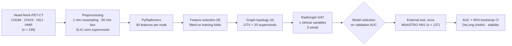
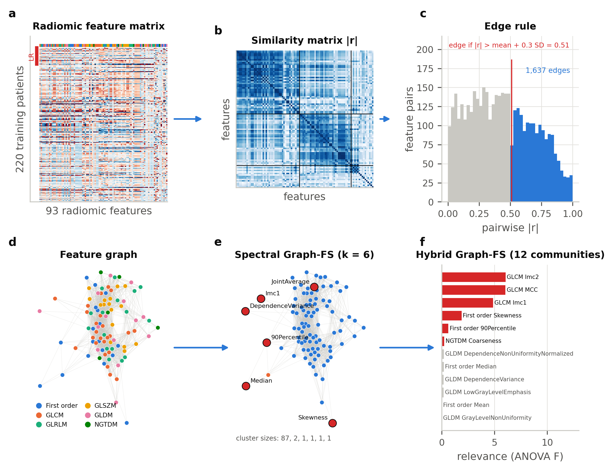
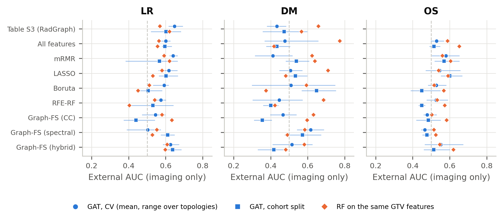
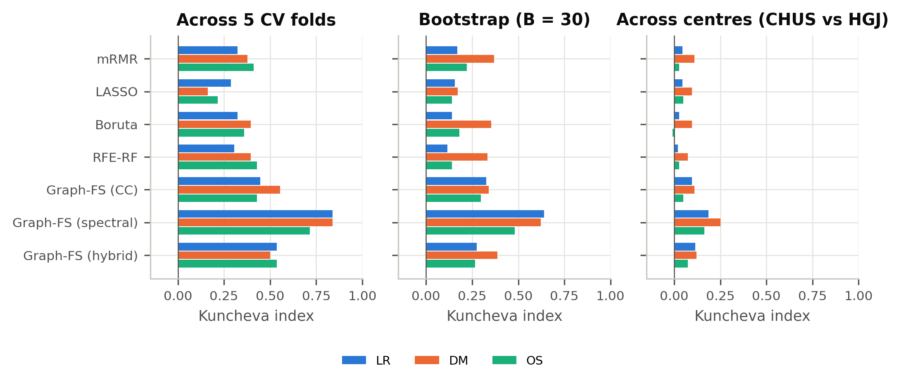
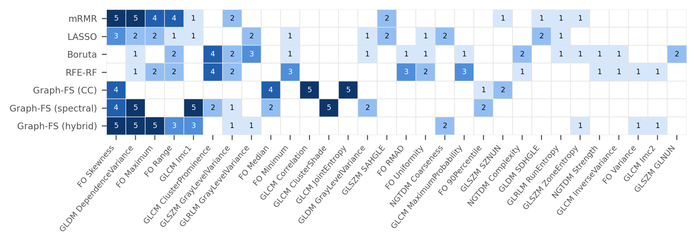
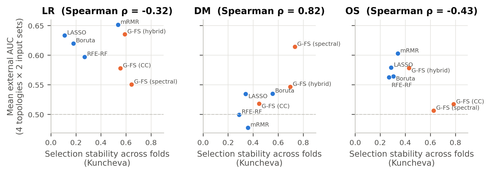
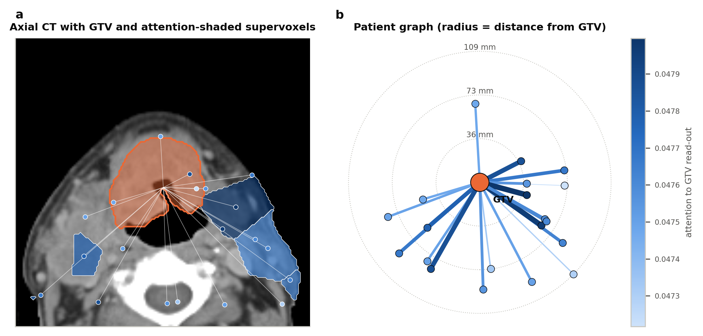

<div align="center">

# Radiomic Graph Attention Network for Head and Neck Cancer

**Reproducibility and external validity of graph-based feature selection in radiomic graph attention networks for outcome prediction in head and neck cancer**

[](https://www.python.org/)
[](https://pytorch.org/)
[](https://pytorch-geometric.readthedocs.io/)
[](https://pyradiomics.readthedocs.io/)
[](#13-reporting-and-reproducibility)
[](LICENSE)
[](#16-citation)

QIRAIL Lab · Department of Radiation Oncology · Christian Medical College (CMC) Vellore, India

</div>

---

## Contents

1. [Summary](#1-summary)
2. [Background and motivation](#2-background-and-motivation)
3. [Key concepts](#3-key-concepts)
4. [Study design](#4-study-design)
5. [Model architecture](#5-model-architecture)
6. [Methods](#6-methods)
7. [Results](#7-results)
8. [Discussion: what the results mean](#8-discussion-what-the-results-mean)
9. [Repository structure](#9-repository-structure)
10. [Installation](#10-installation)
11. [Data](#11-data)
12. [Reproducing the study](#12-reproducing-the-study)
13. [Reporting and reproducibility](#13-reporting-and-reproducibility)
14. [Inference and outputs](#14-inference-and-outputs)
15. [Limitations](#15-limitations)
16. [Citation](#16-citation)
17. [Acknowledgements and references](#17-acknowledgements-and-references)
18. [Keywords and topics](#18-keywords-and-topics)
19. [License](#19-license)

---

## 1. Summary

This project predicts three outcomes after radiotherapy for **head and neck squamous cell carcinoma (HNSCC)** from the planning CT:

| Endpoint | Definition |
|---|---|
| **LR**: locoregional recurrence | event within 2 years |
| **DM**: distant metastasis | event within 2 years |
| **OS**: overall survival | death from any cause within 4 years |

Each patient's tumour and the tissue around it are turned into a **graph**, and a **graph attention network (GAT)** learns from it. The study tests two design questions that earlier work fixed by hand:

1. **Which radiomic features should describe the graph nodes?** Nine feature-selection strategies are compared, including the graph-based method *Graph-FS* and a new *hybrid* variant.
2. **How should the nodes be connected?** Four graph topologies are compared.

Every combination is judged on **how well it predicts** on an independent hospital it never saw (external validation) and on **how reproducible its selected features are**.

**Main findings, in one paragraph.** Graph-based feature selection made the selected features **much more reproducible**: the Kuncheva index across CV folds was 0.64–0.73 for spectral Graph-FS against 0.11–0.34 for LASSO. More reproducible features did **not** predict better, however. For **locoregional recurrence**, the radiomic graph network reached an external AUC of **0.71 (95% CI 0.62–0.81)**, higher than a published CNN on the same external cohort (0.59). Even so, no configuration was significantly better than the original RadGraph configuration. **Distant metastasis and overall survival could not be predicted** with the outcome events available. Finally, **validation AUC did not tell us which models would generalise** (Spearman ρ −0.40 to 0.20). This lesson applies to any study that compares many models on small cohorts.

---

## 2. Background and motivation

### The clinical problem
HNSCC is one of the ten most common cancers worldwide. Most patients with locally advanced disease are treated with radiotherapy, often with concurrent chemotherapy. Patients with the same stage, subsite and treatment still have very different outcomes. Some relapse within months, others are cured. A reliable **pre-treatment risk estimate** could guide treatment intensification for high-risk patients, de-escalation for low-risk patients, and individualised follow-up.

### Why radiomics, and why look beyond the tumour?
**Radiomics** extracts hundreds of quantitative descriptors (intensity, texture, heterogeneity) from routine medical images. Two problems recur in the radiomics literature:

* **The surroundings are ignored.** Most models summarise the tumour as one region. Locoregional and nodal spread, however, happen *through the tissue around the tumour*.
* **Results are hard to reproduce.**
  - Radiomic features depend on the scanner and on processing.
  - The features a selection algorithm picks change when the training data change slightly.
  - Published deep learning models often cannot be retrained to the performance their authors reported.

### Three studies this project builds on

| Study | What it contributed | What it left open |
|---|---|---|
| **RadGraph** (Bae et al., 2025) | Represents each patient as a graph: the tumour (GTV) is the central node and peritumoral **supervoxels** are surrounding nodes. A GAT gathers information from the surroundings into the tumour node. | The node features were a small **fixed** set, and the graph wiring (the "radiomic star") was **fixed**. Neither choice was tested, and the reproducibility of the features was unknown. |
| **Graph-FS** (Moradmand et al., 2025) | Feature selection on a **graph of features**: correlated features form communities, and one representative is kept per community. Much more stable than LASSO, Boruta, RFE or mRMR. | Never combined with graph neural networks, and never tested for externally validated outcome prediction. |
| **Mateus et al.** (2023) | A **reproducible validation protocol** on public data (Canadian centres → Dutch cohort). It showed that reported performance depends strongly on the validation design and on how the training checkpoint is chosen. | Gives a published CNN benchmark on exactly the same external patients. |

### What this project adds
* Combines Graph-FS with a spatial radiomic GAT for the first time.
* Introduces a **hybrid Graph-FS** that balances reproducibility and predictive power.
* Tests the **graph topology** as well as the features.
* Uses a strict **external validation** protocol with a direct comparison to a published CNN.
* Releases code, trained models and the scripts that regenerate every table and figure.

---

## 3. Key concepts

<details>
<summary><b>Click to expand a short glossary (useful if you are new to radiomics or graph neural networks)</b></summary>

| Term | Meaning in this project |
|---|---|
| **GTV** (gross tumour volume) | The primary tumour as outlined by the radiation oncologist on CT. It is the central node of every patient graph. |
| **Supervoxel** | A small 3-D region of neighbouring voxels with similar intensity, produced by the SLIC algorithm. It plays the role of a "super-pixel" in 3-D. The peritumoral tissue is split into about 100 supervoxels and 20 of them become graph nodes. |
| **Radiomic feature** | A number that describes the intensity or texture of a region, for example GLCM contrast or first-order skewness. 93 features are computed per node. |
| **Feature selection** | Choosing a small subset (here 6) of the 93 features, so that the model is not overwhelmed by redundant or noisy inputs. |
| **Graph-FS** | A feature-selection method that builds a graph whose nodes are *features* (not patients). Strongly correlated features are linked, and one representative is kept per group of redundant features. |
| **Graph topology** | The rule that decides which nodes of a patient graph are connected by edges. |
| **GAT** (graph attention network) | A neural network for graphs. Each node updates its representation by combining its neighbours' features, weighted by learned **attention** scores. |
| **Read-out** | The node whose final representation is used for prediction. Here it is the GTV node. |
| **AUC** | Area under the ROC curve: the probability that the model ranks a random patient with the event above a random patient without it. 0.5 = chance, 1.0 = perfect. |
| **External validation** | Testing on patients from a different hospital that were never used for training or model choice. This is the most honest estimate of real-world performance. |
| **Data leakage** | When information from validation or test patients slips into training, for example by selecting features on all patients. Leakage inflates results. This pipeline fits every data-dependent step on training patients only. |
| **Kuncheva index** | A measure of how similar two selected feature sets are, corrected for chance. 1 = identical, 0 = chance agreement. It is used to measure **reproducibility**. |
| **DeLong test** | A statistical test comparing the AUCs of two models on the same patients. |
| **Holm correction** | An adjustment of *p*-values when many comparisons are made, so that "significant" findings are not just luck. |
| **Bootstrap CI** | A confidence interval computed by resampling patients 1000 times. |

</details>

---

## 4. Study design

<p align="center">
  
</p>



### Cohorts
* **Development:** the public **Head-Neck-PET-CT** collection (TCIA) from four hospitals in Québec, Canada: CHUM, CHUS, HGJ and HMR. 199 patients had a CT with a primary GTV.
* **External test:** the public **HN1** collection from MAASTRO Clinic, the Netherlands (137 patients). These patients were **never** used for feature selection, scaling, training or model choice. They were evaluated exactly once.

### Endpoints
These follow Mateus et al.:

* LR and DM: an event **within 2 years** of diagnosis.
* OS: death from any cause **within 4 years**, the median follow-up of the development data.

Patients without an event who were followed for less than the horizon are excluded, because their outcome is unknown. Events after the horizon count as negative.

### Two development designs
The study uses two development designs, because Mateus et al. showed that results depend on the validation design:

| Design (`--mode`) | How the Canadian patients are split | Why |
|---|---|---|
| `MATEUS_CV` (primary) | **5-fold cross-validation** stratified by outcome. The *entire* pipeline (feature selection → scaling → training) is refitted in every fold. External predictions are averaged over the 5 fold models. | Uses all development patients for both training and validation. Every patient is validated exactly once. |
| `MATEUS_COHORT` | **Centre split** (Diamant et al., 2019): train on **HGJ + CHUS**, validate on **HMR + CHUM**. | The validation set comes from different hospitals, so model choice already rewards transfer between centres. |

In both designs, the configuration with the best **validation** AUC is chosen and then tested once on MAASTRO.

### The experimental grid

| Factor | Levels |
|---|---|
| Endpoints | 3 (LR, DM, OS) |
| Feature-selection strategies | 9 (8 for OS, which has no RadGraph reference set) |
| Graph topologies | 4 |
| Input sets | 2 (imaging only; imaging + clinical) |
| Development designs | 2 (5-fold CV; cohort split) |
| Random seeds per configuration | 3 (predictions averaged) |
| Checkpoint rules | 2 (lowest validation loss = primary; Mateus AUC-gap rule = sensitivity analysis) |

This gives 144 GAT configurations per endpoint for LR and DM and 128 for OS, each trained with 3 seeds (and in each of the 5 CV folds).

---

## 5. Model architecture

<p align="center">
  
</p>

### How the model works
1. **Build the graph (left panel).** The patient's GTV becomes the central node (star). 20 peritumoral supervoxels become surrounding nodes. Each node carries the 6 selected radiomic features, and the edges follow the chosen topology.
2. **Message passing.** In each GAT layer, every node collects its neighbours' features. It does not simply average them: it learns **attention weights** that say how much each neighbour should count.
3. **Multi-head attention (right panel).** At each layer, 4 independent attention "heads" do this in parallel and their results are concatenated, followed by layer normalisation and ReLU. Several heads make learning more stable and let the network attend to different patterns at once.
4. **Read-out.** After the last layer, only the **GTV node's** representation (16 numbers) is kept. By then it summarises the tumour *and* what it learned from its surroundings.
5. **Optional clinical fusion.** The GTV embedding can be joined with 16 encoded clinical variables (age, sex, HPV, T and N stage, subsite, chemotherapy).
6. **Prediction.** A linear layer and a sigmoid give the probability of the event.

### Hyper-parameters
The hyper-parameters are taken from RadGraph and were not tuned here, so that the comparison isolates the effect of features and topology:

| Hyper-parameter | LR / OS | DM |
|---|---|---|
| GAT layers | 4 multi-head + 1 single-head output layer | 3 |
| Heads × units per head | 4 × 16 | 4 × 8 |
| Normalisation / activation | graph-wise LayerNorm + ReLU | graph-wise LayerNorm + ReLU |
| Read-out | GTV node embedding (16-d) → dropout → [⊕ clinical] → linear → sigmoid | same, stronger dropout |
| Trainable parameters (with clinical inputs) | 15,057 | 1,841 |
| Loss / class balancing | BCE, per-epoch resampling of both classes to the mean class size | BCE, minority oversampling |
| Optimiser | Adam + linear warm-up, ReduceLROnPlateau, gradient clipping, early stopping (patience 50) | same |
| Checkpoint kept | lowest validation loss (RadGraph); Mateus AUC-gap rule as a sensitivity analysis | same |

The networks are deliberately **small**: about 15k parameters for LR and fewer than 2k for DM. With only 12–19 events in the development data, a larger network would simply memorise the training patients.

---

## 6. Methods

### 6.1 Image preprocessing and radiomic features

| Step | What is done | Why |
|---|---|---|
| Resampling | CT to **1 mm isotropic** voxels (linear); GTV mask with nearest neighbour | Patients scanned with different slice thicknesses become comparable. |
| Peritumoral region | Crop a box extending **50 mm** beyond the GTV and remove the GTV voxels | Defines "the surroundings" in the same way as RadGraph. |
| Supervoxels | **SLIC-zero** splits the region into ~100 supervoxels; those under 8 voxels are discarded | Splits the surroundings into anatomically coherent pieces that become graph nodes. |
| Radiomics | **93 PyRadiomics features** per node, bin width 25 HU: 18 first-order, 24 GLCM, 16 GLRLM, 16 GLSZM, 14 GLDM, 5 NGTDM | Standard, IBSI-aligned intensity and texture descriptors. **Shape** features are excluded because a supervoxel's shape reflects the algorithm, not the tissue. |

### 6.2 Feature selection: 9 strategies, k = 6 features each

Before selection, near-constant features are removed, heavy-tailed features (|skewness| > 2) are log-transformed, and all features are z-scored on the **training** patients. Every data-driven method keeps exactly **6 features**, so that differences come from *which* features are chosen, not *how many*.

| Strategy | Type | How it chooses features |
|---|---|---|
| `table_s3` | reference | The fixed RadGraph feature set (Table S3 of the original paper; 4 features for LR, 6 for DM). |
| `all` | reference | All 93 features, no selection. |
| `mrmr` | supervised | Greedily picks features with high relevance to the outcome (ANOVA F) and low redundancy with features already picked. Used as the OS reference. |
| `lasso` | supervised | L1-penalised logistic regression; features ranked by when they enter the regularisation path. |
| `boruta` | supervised | Keeps features whose random-forest importance beats randomly permuted "shadow" copies. |
| `rfe_rf` | supervised | Recursively removes the least important features of a random forest. |
| `graph_fs_cc` | label-free | **Graph-FS, connected components**: one representative (highest degree centrality) per group of correlated features. |
| `graph_fs_spectral` | label-free | **Graph-FS, spectral**: clusters the feature graph into k groups and keeps the feature closest to each cluster centre. |
| `graph_fs_hybrid` | hybrid (**new**) | Splits the feature graph into communities, takes the **most outcome-relevant** feature of each, and keeps the top 6. |

#### How Graph-FS works, and why the hybrid variant was introduced

<p align="center">
  
</p>

The figure shows the steps on real training data (fold 1, LR: 152 patients, 11 events):

* **(a)** The patients × features matrix.
* **(b)** Absolute correlation between every pair of features.
* **(c)** A pair of features is linked if their correlation exceeds *mean + 0.3 SD* (here 0.49), which gives 1,592 edges.
* **(d)** The resulting **feature graph**.
* **(e)** **Spectral Graph-FS** cuts the graph into 6 clusters and keeps the most central feature of each. Here 88 of 93 features fall in one huge cluster, so 5 of the 6 picks are "loner" features with unusual correlation patterns.
* **(f)** The **hybrid** variant cuts the graph into 17 communities, picks the most outcome-relevant feature in each, and keeps the 6 most relevant.

**Why the hybrid?** Label-free Graph-FS controls redundancy but **ignores the outcome**. It can therefore be perfectly reproducible and still predict nothing. The hybrid keeps the graph's redundancy control, so its selections stay stable, but lets the outcome decide *which* member of each community to keep, so the selected features stay relevant.

### 6.3 Graph topologies (GTV + 20 supervoxels)

<p align="center">
  
</p>

| Topology | Edges | Idea it tests |
|---|---|---|
| **(a)** `radiomic_star` (RadGraph) | GTV ↔ the 20 supervoxels **most similar to it in feature space** | Tissue that "looks like" tumour matters, wherever it is. |
| **(b)** `spatial_star` | GTV ↔ the 20 supervoxels **nearest to it in physical space** | The immediate surroundings matter, which is how invasion actually spreads. |
| **(c)** `radiomic_knn` | radiomic star + edges between each node and its 4 nearest neighbours in feature space | Supervoxels can also exchange information with each other. |
| **(d)** `spatial_knn` | spatial star + edges between each node and its 4 nearest physical neighbours | The same, along anatomical neighbourhoods. |

In the radiomic star **(a)**, the connected supervoxels can lie far from the tumour. In the spatial star **(b)**, they hug it. Node features are z-scored with the training GTV statistics and clipped at ±5.

### 6.4 Comparators

These comparators are what make the conclusions about the GAT meaningful:

* **Reference GAT:** the published RadGraph configuration (Table S3 features + radiomic star). For OS, which has no published set, mRMR + radiomic star. Every other configuration is tested **against this reference**.
* **Random forest on the same GTV features:** it sees the tumour but not the surroundings. If the GAT beats it, the **peritumoral graph** adds information.
* **Clinical-only random forest:** shows what can be achieved without any imaging.

### 6.5 Statistics
* **Discrimination:** AUC with a 95% percentile bootstrap CI (1000 resamples).
* **Comparisons:** paired **DeLong** tests against the reference and against the matching RF, with **Holm** correction across the configurations within each endpoint/design/input set.
* **Reproducibility:** **Kuncheva index** (also Jaccard and Kendall's W), measured in three settings:
  1. across the 5 CV folds;
  2. across 30 bootstrap resamples of the training data in each fold;
  3. between selections made separately in the two largest centres, CHUS and HGJ.
* **Associations:** Spearman's ρ (stability ↔ external AUC; validation AUC ↔ external AUC).

---

## 7. Results

### 7.1 Patient cohorts

| | Head-Neck-PET-CT (training / validation) | MAASTRO HN1 (external test) |
|---|---|---|
| Patients with CT and GTV | 199 | 137 |
| Age, median (IQR), y | 63 (57–70) | 61 (56–67) |
| Male sex | 147 (74%) | 111 (81%) |
| HPV positive / negative / unknown | 74 / 19 / 106 | 23 / 58 / 56 |
| Oropharynx / larynx | 199 / 0 | 88 / 49 |
| Concurrent chemotherapy | 173 (87%) | 37 (27%) |
| **LR**, patients (events) | 190 (13, 6.8%) | 121 (30, 24.8%) |
| **DM**, patients (events) | 191 (12, 6.3%) | 109 (7, 6.4%) |
| **OS**, patients (events) | 92 (19, 20.7%) | 135 (45, 33.3%) |

**What this table tells us.** The two cohorts are clearly different populations:

* All development patients had **oropharyngeal** cancer, whereas a third of the test patients had **laryngeal** cancer.
* HPV-positive disease and chemotherapy were much more common in Canada.
* Most importantly, **events are very scarce** in the development data: only 13 LR, 12 DM and 19 OS events. Each CV validation fold therefore contained only **2–3 LR or DM events**. This one fact explains much of what follows.

The image set available here covers 199 of the 298 eligible Canadian patients. The patients without images carried more than half of the events (30 LR, 27 DM and 44 OS events in the full clinical file).

### 7.2 External performance: the main table

**How to read the table:**
* *Val. AUC* is the score used to **choose** the configuration.
* *Test AUC* is the honest external result on MAASTRO, with a 95% CI.
* *Reference* is the published RadGraph configuration.
* *p* is the Holm-corrected DeLong test of the chosen GAT against the reference; *p* ≥ 0.05 means no significant difference.

| Endpoint | Design | Inputs | Chosen GAT (configuration) | Val. AUC | **Test AUC, chosen GAT** | Test AUC, reference GAT | Test AUC, RF | Test AUC, clinical-only RF | *p* |
|---|---|---|---|:-:|:-:|:-:|:-:|:-:|:-:|
| **LR** | 5-fold CV | Img | Boruta + radiomic kNN | 0.71 | 0.61 [0.50, 0.72] | 0.63 [0.51, 0.75] | 0.56 [0.45, 0.68] | – | 1.00 |
| | 5-fold CV | Img+Clin | All + radiomic kNN | 0.74 | 0.58 [0.46, 0.69] | 0.69 [0.59, 0.80] | – | 0.66 [0.56, 0.76] | 1.00 |
| | Cohort split | Img | All + radiomic kNN | 0.75 | 0.63 [0.51, 0.75] | 0.52 [0.41, 0.64] | 0.56 [0.44, 0.68] | – | 1.00 |
| | Cohort split | Img+Clin | Graph-FS (spectral) + radiomic kNN | 0.80 | **0.71 [0.62, 0.81]** | 0.55 [0.43, 0.67] | – | 0.63 [0.52, 0.75] | 0.72 |
| **DM** | 5-fold CV | Img | All + radiomic kNN | 0.64 | 0.66 [0.49, 0.82] | 0.41 [0.24, 0.58] | 0.58 [0.34, 0.79] | – | 0.24 |
| | 5-fold CV | Img+Clin | All + radiomic kNN | 0.56 | 0.65 [0.44, 0.85] | 0.60 [0.32, 0.85] | – | 0.80 [0.70, 0.89] | 1.00 |
| | Cohort split | Img | RFE-RF + spatial star | 0.81 | 0.36 [0.14, 0.60] | 0.40 [0.22, 0.56] | 0.60 [0.43, 0.77] | – | 1.00 |
| | Cohort split | Img+Clin | All + radiomic star | 0.75 | 0.19 [0.10, 0.31] | 0.68 [0.44, 0.87] | – | 0.70 [0.57, 0.81] | <0.01 |
| **OS** | 5-fold CV | Img | Graph-FS (spectral) + spatial kNN | 0.69 | 0.46 [0.35, 0.56] | 0.62 [0.52, 0.72] | 0.52 [0.41, 0.62] | – | 0.20 |
| | 5-fold CV | Img+Clin | Graph-FS (spectral) + spatial kNN | 0.69 | 0.47 [0.36, 0.57] | 0.66 [0.56, 0.75] | – | 0.60 [0.51, 0.69] | 0.11 |
| | Cohort split | Img | Graph-FS (spectral) + spatial kNN | 0.73 | 0.45 [0.35, 0.56] | 0.56 [0.46, 0.66] | 0.52 [0.42, 0.63] | – | 1.00 |
| | Cohort split | Img+Clin | Graph-FS (spectral) + spatial kNN | 0.73 | 0.48 [0.37, 0.57] | 0.62 [0.52, 0.73] | – | 0.42 [0.32, 0.53] | 0.56 |

<p align="center">
  
  <br><em>External ROC curves on MAASTRO. Rows: LR, DM, OS. Columns: design × inputs. The chosen GAT is shown with its 95% bootstrap band.</em>
</p>

#### What the main table shows

* **Locoregional recurrence carries a real but modest signal.**
  - The best external result was **0.71 [0.62–0.81]** (cohort split, imaging + clinical), well above chance and above the clinical-only model (0.63).
  - Across the whole grid of 144 LR configurations, **93% scored above 0.5** (median 0.62, range 0.37–0.72). LR is the only endpoint where the radiomic graph worked consistently.
* **No configuration beat the published RadGraph reference significantly** (all *p* ≥ 0.72 for LR). In 5-fold CV the reference was even numerically the better GAT (0.63 and 0.69). Tuning features and topology did **not** bring a reliable improvement.
* **Distant metastasis is unpredictable here.**
  - With only **7 external DM events**, the confidence intervals span most of the 0–1 range.
  - The chosen models varied from 0.19 to 0.66.
  - Every DM configuration that differed significantly from the reference (7 of 144) was **worse**.
  - The strongest DM model was the **clinical-only** random forest (0.80). This fits nodal stage being the main driver of distant spread.
* **Overall survival failed with the chosen models** (0.45–0.48). Yet the pre-specified mRMR reference reached 0.62–0.66. The data-driven choice on validation picked the *wrong* models: see [7.6](#76-validation-auc-does-not-predict-external-auc).

<p align="center">
  
  <br><em>External AUC with 95% CI for every endpoint, design and input set. The dashed line marks chance (0.5).</em>
</p>

### 7.3 Comparison with a published CNN on the same external patients

Mateus et al. (2023) trained a convolutional neural network on the same collections, with the same two designs, and tested it on the same MAASTRO patients. This makes a direct, fair benchmark.

CV rows: mean AUC (range) over the 5 fold models. Cohort-split rows: AUC [95% CI].

| Endpoint | Design | Inputs | This study (GAT) | Mateus et al. CNN |
|---|---|---|:-:|:-:|
| LR (2 y) | 5-fold CV | Img | 0.51 (0.41–0.62) | 0.53 (0.48–0.59) |
| | 5-fold CV | Img+Clin | 0.56 (0.53–0.63) | 0.57 (0.53–0.60) |
| | Cohort split | Img | **0.63** [0.51, 0.75] | 0.45 [0.32, 0.57] |
| | Cohort split | Img+Clin | **0.71** [0.62, 0.81] | 0.59 [0.47, 0.70] |
| DM (2 y) | 5-fold CV | Img | 0.59 (0.38–0.76) | **0.83** (0.76–0.90) |
| | 5-fold CV | Img+Clin | 0.50 (0.20–0.76) | **0.88** (0.86–0.90) |
| | Cohort split | Img | 0.36 [0.14, 0.60] | **0.89** [0.79, 0.98] |
| | Cohort split | Img+Clin | 0.19 [0.10, 0.31] | **0.93** [0.86, 0.99] |
| OS (4 y) | 5-fold CV | Img | 0.45 (0.42–0.49) | **0.63** (0.57–0.72) |
| | 5-fold CV | Img+Clin | 0.48 (0.44–0.53) | **0.68** (0.63–0.71) |
| | Cohort split | Img | 0.45 [0.35, 0.56] | **0.67** [0.57, 0.77] |
| | Cohort split | Img+Clin | 0.48 [0.37, 0.57] | **0.69** [0.59, 0.79] |

**Interpretation.**

* **LR.** The graph network matched the CNN in cross-validation and **exceeded it in the cohort split** (0.71 vs 0.59). Mateus et al. reported that their CNN lost almost all discrimination for LR on MAASTRO. A representation that explicitly models the peritumoral tissue may capture information on locoregional failure that a single-slice CNN misses.
* **DM and OS.** The CNN was far better. Most of this gap is explained by the **development data**, not the method:
  - The CNN was trained on 297 Canadian patients. This study had images for 199.
  - The images available here contain fewer than half of the DM and OS events: 12 vs 27 DM, 19 vs 44 OS.
  - All development patients were oropharyngeal, while a third of the test patients had laryngeal cancer.

  This comparison is therefore **indicative, not conclusive**.

### 7.4 Does feature selection or topology matter?

<p align="center">
  
  <br><em>Mean external AUC for each feature-selection strategy (rows) × topology (columns), averaged over designs and input sets. Blue = above 0.5, red = below.</em>
</p>

**Topology had almost no effect on LR.** Mean external AUC averaged over selectors, designs and inputs:

| Topology | LR | DM | OS |
|---|:-:|:-:|:-:|
| Radiomic star (RadGraph) | 0.59 | 0.52 | 0.55 |
| Spatial star | 0.61 | 0.49 | 0.52 |
| Radiomic kNN | 0.61 | 0.52 | **0.58** |
| Spatial kNN | **0.62** | 0.49 | 0.50 |

For OS the radiomic topologies did slightly better than the spatial ones, but **no difference survived correction for multiple testing**.

**Clinical variables helped every endpoint.** Mean external AUC over the grid:

| | LR | DM | OS |
|---|:-:|:-:|:-:|
| Imaging only | 0.58 | 0.49 | 0.52 |
| Imaging + clinical | **0.63** | **0.53** | **0.56** |

### 7.5 Does the peritumoral graph add anything beyond the tumour?

Each GAT is compared with a random forest trained on **exactly the same GTV features**. The forest sees only the tumour, while the GAT also sees the surroundings.

| Endpoint | Design | GAT better than RF (feature sets) | Mean AUC, GAT | Mean AUC, RF | Significant (Holm) |
|---|---|:-:|:-:|:-:|:-:|
| LR | 5-fold CV | **7/9** | **0.59** | 0.57 | 0 |
| LR | Cohort split | **6/9** | **0.57** | 0.55 | 0 |
| DM | 5-fold CV | 1/9 | 0.49 | **0.65** | 1 |
| DM | Cohort split | 4/9 | 0.49 | 0.50 | 0 |
| OS | 5-fold CV | 4/8 | 0.53 | 0.54 | 0 |
| OS | Cohort split | 1/8 | 0.51 | **0.59** | 0 |

<p align="center">
  
</p>

**Interpretation.**

* **LR:** the GAT beat the forest for most feature sets (7 of 9 in CV), although each individual difference was small and not significant. This consistent direction suggests that the **peritumoral tissue holds some information about locoregional failure** beyond the tumour itself, which is biologically plausible because locoregional relapse spreads through that tissue.
* **DM and OS:** the forest was at least as good as the GAT. Distant spread and death are less tied to the local surroundings.

### 7.6 Feature-selection stability: the reproducibility result

**How to read the table:** Kuncheva index; 1 = the same features are picked every time, 0 = no better than random. The best value in each column is in bold.

| Method | CV folds LR | CV folds DM | CV folds OS | Bootstrap LR | Bootstrap DM | Bootstrap OS | Centres LR | Centres DM |
|---|:-:|:-:|:-:|:-:|:-:|:-:|:-:|:-:|
| mRMR | 0.54 | 0.36 | 0.34 | 0.29 | 0.23 | 0.21 | 0.06 | 0.07 |
| LASSO | 0.11 | 0.34 | 0.29 | 0.16 | 0.13 | 0.19 | 0.03 | 0.11 |
| Boruta | 0.18 | 0.55 | 0.31 | 0.13 | 0.18 | 0.21 | 0.05 | 0.00 |
| RFE-RF | 0.27 | 0.29 | 0.27 | 0.13 | 0.17 | 0.22 | 0.05 | 0.04 |
| Graph-FS (CC) | 0.55 | 0.45 | **0.79** | 0.31 | 0.34 | 0.38 | 0.12 | 0.00 |
| **Graph-FS (spectral)** | **0.64** | **0.73** | 0.63 | **0.55** | **0.54** | **0.43** | **0.21** | **0.18** |
| Graph-FS (hybrid) | 0.59 | 0.70 | 0.43 | 0.38 | 0.34 | 0.29 | 0.11 | 0.11 |

Stability across centres could not be estimated for OS because there were fewer than 3 events per centre.

<p align="center">
  
</p>

**What this shows.**

* **Graph-FS is clearly the most reproducible family.** Spectral Graph-FS was the most stable method for LR and DM in every setting. For example, its CV-fold index was 0.64 for LR, against **0.11 for LASSO**: LASSO picked almost a completely different set of features in each fold.
* The **supervised selectors** (LASSO, Boruta, RFE-RF) were the least stable.
* **Selections made in different hospitals agreed poorly for every method** (at most 0.21). Even the best selector partly reflects centre-specific patterns.

**Why Graph-FS is so stable.** Radiomic texture features are highly inter-correlated. At the Graph-FS threshold, almost all of them form **one big community**. A few features with distinctive correlation patterns form their own small communities:

* first-order skewness and median;
* GLCM informational measure of correlation and cluster shade;
* GLDM dependence variance.

That community structure barely changes when the training patients change, so Graph-FS keeps picking the same "loner" features. Spectral Graph-FS chose GLCM informational measure of correlation, GLCM cluster shade and GLDM dependence variance in **all five folds**. LASSO, Boruta and RFE-RF instead picked a *different* member of the big correlated community in almost every fold.

<p align="center">
  
  <br><em>In how many of the 5 CV folds each feature was selected, by each strategy (LR). Graph-FS rows show solid, repeated choices; LASSO, Boruta and RFE rows are scattered.</em>
</p>

### 7.7 Stability does not mean better prediction

<p align="center">
  
</p>

Across selectors, stability was **not** associated with external AUC: Spearman ρ = −0.32 for LR and −0.43 for OS. The positive value for DM (ρ = 0.82) rests on only 7 external events and should not be trusted. For LR, the most stable method (spectral Graph-FS) was among the *least* predictive. **mRMR** (Kuncheva 0.54) and the **hybrid Graph-FS** (0.59) combined fairly high stability with the best external LR AUCs.

### 7.8 Validation AUC does not predict external AUC

<p align="center">
  
  <br><em>Each point is one GAT configuration. If validation were a good guide, the points would follow the diagonal. They do not.</em>
</p>

Across configurations, the correlation between validation AUC and external AUC ranged from **ρ = −0.40** (OS, CV) to **ρ = 0.20** (LR, cohort split), and was −0.08 for LR in CV. Two observations show how noisy validation was:

* The five fold models of the *same* chosen LR configuration had external AUCs ranging from **0.41 to 0.62**.
* The RadGraph reference scored a validation AUC of only **0.28** in the cohort split, yet reached **0.63** externally in CV.

**Why?** With only 2–3 events per validation fold, a single patient changes the validation AUC a lot. When more than 100 configurations are compared on such noisy numbers, the "best" one is largely a **random draw**. Its validation AUC is optimistic and its external performance is unpredictable. This is why the **pre-specified reference sometimes beat the data-driven choice**.

### 7.9 Sensitivity analysis and attention

* **Checkpoint rule.** Replacing "lowest validation loss" with the Mateus AUC-gap rule changed the reference configuration's external AUC by a median of **0.01** (at most 0.13). The chosen configurations changed more, because the rule also changed which configuration ranked first. The overall conclusions were unaffected.
* **Attention is nearly uniform.** The GTV node's attention to individual supervoxels stayed within about **±2%** of the patient mean. It showed **no dependence on distance** from the tumour and no difference between patients with and without recurrence. For this example patient, the values ranged from 0.047 to 0.048, against a uniform value of 0.048. At this sample size, the attention maps **cannot be interpreted as showing where the risk is**.

<p align="center">
  
  <br><em>Attention of the GTV read-out for an external patient with locoregional recurrence. (a) Supervoxels on the CT, shaded by attention. (b) The patient graph. The near-uniform shading is the finding.</em>
</p>

---

## 8. Discussion: what the results mean

**1. Graph-FS solves the reproducibility problem, but reproducibility alone is not enough.** Graph-based selection gave far more reproducible node features than LASSO, Boruta and RFE-RF. This confirms the original Graph-FS study in a different setting: perturbing the training patients rather than the radiomic extraction settings. Label-free Graph-FS, however, keeps "distinctive" features because they are structurally isolated, *not* because they are prognostic. Label-driven selectors pick a different but roughly interchangeable correlated feature each time. That is unstable, but not necessarily less predictive.

**2. The hybrid Graph-FS is a sensible default.** By keeping the graph's redundancy control and letting the outcome choose within each community, the hybrid was both stable (Kuncheva 0.59 for LR) and among the best LR selectors externally. It is a reasonable choice when reproducibility and discrimination must be balanced, although the evidence here is not definitive.

**3. At this sample size, the GAT acts as a smoothed aggregator.** Topology barely mattered and attention was nearly uniform. The network therefore averaged the peritumoral information rather than learning which regions matter. RadGraph obtained informative attention maps from more than 1,500 training patients; here there were 13 LR events. Even so, beating the tumour-only random forest for most LR feature sets suggests that the surroundings do contain some signal.

**4. Validation-based model selection is unreliable on small cohorts.** This is the most important lesson for practice, and it applies beyond graph networks. When many models are compared on validation folds with 2–3 events, the winner reflects noise. Studies like this should:

* **fix a reference configuration in advance** and report it next to any data-driven choice;
* report the **distribution** of external performance across the whole grid, not just the best result;
* test differences formally, **with correction for multiple comparisons**.

**5. More events are needed before radiomic graph designs can be ranked.** The DM and OS failures, and the gap to the CNN, track the number of available events. That number is far below common sample-size recommendations for prediction models.

---

## 9. Repository structure

```
.
├── README.md                          ← this file
├── LICENSE                            MIT
├── radgraph-hnscc/                    ← study code (start here)
│   ├── main.py                        CLI for every pipeline stage
│   ├── run_mateus_study.sh            the full study: LR, DM, OS × both designs × both checkpoint rules
│   ├── export_results.py              study-level CSVs, ROC figures, final model copies
│   ├── predict.py                     inference with the saved models (cohort patients or new NIfTI)
│   ├── check_setup.py                 environment and data check
│   ├── install_deps.sh, requirements.txt
│   ├── README.md                      detailed pipeline documentation
│   └── radgraph/
│       ├── config.py                  cohorts, designs, FS × topology grid, GAT hyper-parameters
│       ├── data/                      clinical labels, CT/GTV loading, preprocessing, SLIC, PyRadiomics, splits
│       ├── selection/                 9 selectors incl. Graph-FS; stability metrics
│       ├── graphs/                    4 topologies; PyG datasets; class-balanced sampler
│       ├── models/gat.py              RadGraph GAT
│       ├── engine/                    training, evaluation (+ attention), RF baselines
│       ├── experiments/               benchmark grid, cross-fold summary, export
│       ├── inference.py               checkpoint loading and ensemble prediction
│       ├── stats.py, utils.py         DeLong, Holm, bootstrap CI, seeding
│       └── viz/                       all figures and the HTML report
├── Paper/
│   ├── manuscript/                    LaTeX manuscript + Supplementary Information
│   │   ├── main.tex, supplementary.tex, references.bib
│   │   ├── figures/, tables/          generated; numbers.tex holds every number quoted in the text
│   │   └── scripts/make_paper_assets.py   regenerates all figures, tables and numbers from the results
│   └── *.pptx, RadGAT_poster.png      figure sources, slides and poster
├── architecture_diagram/              architecture figure
├── paper_workflow_v2/                 study rationale, GAT explainer, implementation audit, supervoxel documentation
└── paper_workflow/                    earlier drafts and notes
```

For a gentle, illustrated introduction, read the documents in [`paper_workflow_v2/`](paper_workflow_v2/):

* `01`: study rationale, design and methods;
* `02`: graph attention networks explained;
* `03`: implementation history and audit;
* `04`: how the supervoxels are generated.

---

## 10. Installation

Tested on Ubuntu (Linux 5.15) with Python 3.8, CUDA 11.7 and an NVIDIA GPU. The pipeline also runs on CPU, but more slowly.

```bash
git clone https://github.com/hash123shaikh/Radiomics_Graph_Attention_Network_HNC.git
cd Radiomics_Graph_Attention_Network_HNC/radgraph-hnscc

conda create -n GNNvenv python=3.8 -y
conda activate GNNvenv
bash install_deps.sh          # or: pip install numpy==1.24.3 "setuptools>=65" && pip install -r requirements.txt
```

The main pinned versions are `torch 2.0.1`, `torch-geometric 2.3.1`, `pyradiomics 3.0.1`, `SimpleITK 2.2.1`, `scikit-learn 1.3.0` and `mrmr-selection 0.2.6`. `torch-scatter`, `torch-sparse` and `torch-cluster` are **not** required. If you install them anyway, they must match the CUDA build of torch.

---

## 11. Data

Both cohorts are public on [The Cancer Imaging Archive (TCIA)](https://www.cancerimagingarchive.net/). **No patient data are included in this repository.** Download the data yourself and arrange it as shown below.

| Cohort | Role | Source |
|---|---|---|
| Head-Neck-PET-CT (CHUM, CHUS, HGJ, HMR) | training / validation | [TCIA Head-Neck-PET-CT](https://doi.org/10.7937/K9/TCIA.2017.8oje5q00). CT + primary-GTV NIfTI as distributed by the [HECKTOR challenge](https://hecktor.grand-challenge.org/); outcomes from `INFOclinical_HN_Version2_30may2018.xlsx` |
| MAASTRO HN1 | external test only | [TCIA HN1](https://doi.org/10.7937/tcia.2019.8kap372n): DICOM CT + RTSTRUCT and the clinical table |

```
radgraph-hnscc/data/
├── HECKTOR 2026 Training Data/
│   ├── INFOclinical_HN_Version2_30may2018.xlsx        sheets CHUM, CHUS, HGJ, HMR
│   └── Images/<ID>/<ID>__CT.nii.gz, <ID>.nii.gz       mask: 1 = primary GTV, 2 = nodal GTV
└── MAASTRO/
    ├── clinical_data.csv                              HN1 clinical table (patient_id, outcomes, …)
    └── Images/<HN1xxxx>/CT/*.dcm, RTSTRUCT/*.dcm
```

The paths and column mappings are set in [`radgraph-hnscc/radgraph/config.py`](radgraph-hnscc/radgraph/config.py). Run `python check_setup.py` to check the environment, the files, and the number of patients and events for each endpoint.

---

## 12. Reproducing the study

```bash
cd radgraph-hnscc
python check_setup.py                       # 1. environment + data
./run_mateus_study.sh                       # 2. full study (set PY=/path/to/python if not using the active env)
python export_results.py                    # 3. collect results → outputs/results/ (no retraining)
python ../Paper/manuscript/scripts/make_paper_assets.py   # 4. regenerate every figure, table and number of the paper
```

The pipeline runs as a series of stages. Each stage stores its output, so an interrupted run resumes where it stopped:

| Stage (`--stage`) | What it does | Output |
|---|---|---|
| `preprocess` | CT + primary GTV → 1 mm, 50 mm box, SLIC supervoxels | `outputs/cache/preprocessed/` |
| `extract` | 93 PyRadiomics features for the GTV and every supervoxel | `outputs/cache/features/` |
| `select` | every feature-selection method on the training split | `runs/<run>/selection/` |
| `stability` | bootstrap and cross-centre stability | `selection/stability_*.csv` |
| `benchmark` | graphs, GAT grid, RF baselines | `graphs/`, `models/`, `predictions/` |
| `summary` | seed-ensembled AUC + CI, DeLong/Holm, figures | `results_summary.csv`, `figures/`, `report.html` |

Use `--force` to recompute a stage. Examples:

```bash
python main.py --mode MATEUS_CV     --task DM --from_stage select                         # 5 folds + cross-fold summary
python main.py --mode MATEUS_CV     --task OS --from_stage select --fold 3                # a single fold
python main.py --mode MATEUS_COHORT --task LR --from_stage select --epoch_rule auc_gap    # Mateus checkpoint rule
python main.py --mode MATEUS_CV     --task LR --stage benchmark \
               --methods graph_fs_spectral mrmr --topologies radiomic_star --seeds 42     # a subset of the grid
```

The full study is compute-intensive (3 endpoints × 2 designs × 2 checkpoint rules × ~144 configurations × 3 seeds, with 5 folds in CV). Finished models are cached, so re-running the script only computes what is missing.

---

## 13. Reporting and reproducibility

* **Reporting guidelines:** TRIPOD (type 3, external validation) and CLAIM.
* **No data leakage:** feature selection, scaling, clinical encoding and model fitting use **training patients only**. Model choice uses validation only. MAASTRO is evaluated **once**.
* **Determinism:** fixed seeds (3 per configuration, probabilities averaged), cached stages and pinned dependency versions.
* **Traceable numbers:** every number, table and figure in the manuscript is generated by `make_paper_assets.py` from the result CSVs. Nothing is typed by hand.
* **Checkpoint fidelity:** re-applying the stored models reproduces the reported external predictions to within 10⁻⁷.
* **Honest comparison:** a pre-specified reference, results reported for the whole grid, and Holm-corrected tests.

---

## 14. Inference and outputs

Every saved checkpoint is **self-contained**. It stores the weights, hyper-parameters, selected features, training scaler, clinical encoder, decision threshold and topology, so no retraining is needed:

```bash
python predict.py --task LR --dataset MAASTRO                                       # chosen CV ensemble, whole cohort
python predict.py --task OS --design MATEUS_COHORT --inputs imaging+clinical --dataset MAASTRO
python predict.py --task DM --config mrmr__spatial_star --dataset MAASTRO --patients HN1004 HN1006
python predict.py --task LR --ct new/CT.nii.gz --mask new/GTV.nii.gz --id NEW001    # a new patient
```

For each patient the output gives the ensemble probability, the spread across ensemble members, high or low risk at the validation Youden threshold, and the label when it is known.

> **Trained models** are not tracked in git. Download them from the [GitHub Releases](https://github.com/hash123shaikh/Radiomics_Graph_Attention_Network_HNC/releases) page (`radgraph-hnscc_final_models_v3.zip`) and unzip the file into `radgraph-hnscc/outputs/`. These models were trained with preprocessing v3. Before running `predict.py`, set `PREPROCESS_VERSION = 3`, `USE_BODY_MASK = False` and `SLIC_HU_WINDOW = None` in `radgraph/config.py`.

| Result file (`radgraph-hnscc/outputs/results/`) | Content |
|---|---|
| `main_results.csv` | for each endpoint × design × checkpoint rule × inputs: chosen GAT, reference GAT, best RF and clinical-only RF, with validation AUC, external AUC [95% CI], fold range and Holm-corrected DeLong *p* |
| `all_configurations.csv` | every configuration of every run |
| `feature_selection_stability.csv` | stability of every selector across CV folds, bootstrap resamples and centres |
| `cohort_summary.csv` | patients and events for each endpoint and cohort |
| `predictions/*.csv` | per-patient probabilities (out-of-fold validation + external test) |
| `figures/` | ROC curves, per-fold ROC curves, AUC overview |
| `runs/<MODE>_<TASK>/report.html` | self-contained HTML report of each run |

---

## 15. Limitations

* **Few events.** The development image set covered 199 of the 298 Canadian patients, was all oropharyngeal, and contained fewer than half of the events. The full collection is needed for a fair comparison with Mateus et al.
* **DM external set.** With 7 external DM events, DM results cannot be interpreted beyond their confidence intervals.
* **Cohort shift.** The test cohort includes laryngeal cancers, more HPV-negative patients and less chemotherapy.
* **One extraction setting.** Stability was measured across data resamples and centres, not across radiomic extraction settings as in the original Graph-FS study.
* **Supervoxel stage.** The reported results use preprocessing v3. In v3 the 50 mm box extends beyond the skin, so a median of 22% of supervoxels were mostly air. The code now defaults to preprocessing v4, which adds a body mask and a soft-tissue window to make the peritumoral nodes more anatomically meaningful. The study has not yet been re-run with v4.
* **Hyper-parameters** were taken from RadGraph, not tuned, and OS reused the LR settings.
* **Binary horizons** discard censored patients. A survival formulation could use the data more efficiently.
* **Fixed k = 6** for every selector, chosen for comparability. `--k native` lets each selector use its own size.

---

## 16. Citation

The manuscript is in preparation. Until it is published, please cite this repository:

```bibtex
@misc{shaikh_radgat_hnc,
  author       = {Shaikh, Hasan},
  title        = {Reproducibility and external validity of graph-based feature selection in radiomic
                  graph attention networks for outcome prediction in head and neck cancer},
  year         = {2026},
  howpublished = {\url{https://github.com/hash123shaikh/Radiomics_Graph_Attention_Network_HNC}},
  note         = {QIRAIL Lab, Department of Radiation Oncology, Christian Medical College Vellore}
}
```

---

## 17. Acknowledgements and references

This work builds on:

* **RadGraph:** Bae et al. Spatial radiomic graph with graph attention network for outcome prediction in head and neck cancer. *Radiology: Imaging Cancer*, 2025.
* **Graph-FS:** Moradmand et al. Graph-based feature selection for reproducible radiomics. *Scientific Reports* 15, 27995 (2025).
* **Validation design and CNN benchmark:** Mateus et al. *Scientific Reports* 13, 18176 (2023).
* **Cohort split:** Diamant et al. Deep learning in head & neck cancer outcome prediction. *Scientific Reports* 9, 2764 (2019).
* **Data:** Vallières et al., Head-Neck-PET-CT (TCIA, 2017); Wee & Dekker, HN1 (TCIA, 2019); Clark et al., The Cancer Imaging Archive (2013).
* **Methods:** Veličković et al., Graph Attention Networks (ICLR 2018); Achanta et al., SLIC superpixels (2012); van Griethuysen et al., PyRadiomics (2017); Kuncheva, stability index (2007); DeLong et al. (1988); Holm (1979).
* **Software:** PyTorch, PyTorch Geometric, PyRadiomics, scikit-learn, SimpleITK.

The original RadGraph authors' code is not redistributed here. Please obtain it from its authors.

---

## 18. Keywords and topics

**Keywords:** head and neck cancer · HNSCC · radiomics · graph neural network · graph attention network · feature selection · Graph-FS · reproducibility · external validation · radiotherapy outcome prediction · locoregional recurrence · distant metastasis · overall survival · supervoxels · SLIC · PyRadiomics · TCIA

**GitHub topics:** `radiomics` `graph-neural-networks` `graph-attention-network` `head-and-neck-cancer` `feature-selection` `medical-imaging` `pytorch-geometric` `pyradiomics` `outcome-prediction` `radiotherapy` `reproducibility` `deep-learning` `tcia` `external-validation`

---

## 19. License

The code is released under the [MIT License](LICENSE). The licence covers the code and documentation in this repository only. The imaging and clinical data stay under their TCIA licences, and the cited third-party works stay under their own terms.
