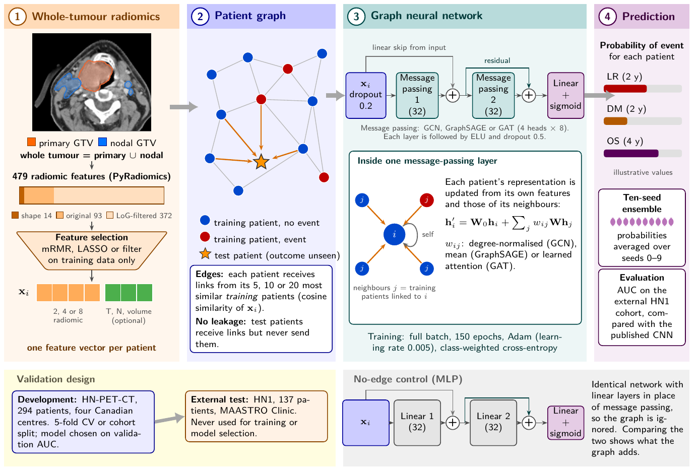

# Graph neural networks on primary and nodal tumour radiomics for outcome prediction in head and neck cancer

Code and manuscript of a multicentre external validation study. Patient-similarity graph neural networks
(GCN, GraphSAGE, GAT) built on CT radiomic features of the whole tumour (primary and nodal gross tumour
volumes) are compared with a published convolutional neural network (CNN) on its public benchmark
protocol (Mateus et al., *Sci Rep* 2023), and every graph model is compared with the identical network
without edges.

<p align="center">
  
</p>

## Main findings

* With whole-tumour features, the graph networks chosen on validation reached external AUCs of 0.59–0.63
  for locoregional recurrence, 0.85–0.87 for distant metastasis and 0.70–0.73 for overall survival, and
  exceeded the CNN in 9 of 12 settings (6 of 12 with primary-GTV features).
* The gain came from the tumour definition: describing the primary and nodal GTVs together, not adding
  nodal burden as a clinical variable.
* The patient graph added nothing: the same network without edges exceeded the CNN in 8 of 12 settings,
  only 1 of 18 paired graph-versus-edgeless differences was significant (in favour of the edgeless
  network), and with identical features the graph network was better on the external cohort in 29% of
  1944 matched comparisons.

## Data

Public collections from The Cancer Imaging Archive (not redistributed here):

| Cohort | Role | Collection |
|---|---|---|
| Head-Neck-PET-CT (CHUM, CHUS, HGJ, HMR), 294 patients | development | <https://doi.org/10.7937/K9/TCIA.2017.8oje5q00> |
| HN1 (MAASTRO), 137 patients | external test | <https://doi.org/10.7937/tcia.2019.8kap372n> |

Expected layout (override with `HNC_DATA_DIR`, or per cohort `HNC_HNPET_DIR` / `HNC_MAASTRO_DIR`):

```
data/
├── Head-Neck-PET-CT/
│   ├── Images/HN-<centre>-<nnn>/CT/*.dcm, RTSTRUCT/*.dcm
│   ├── INFOclinical_HN_Version2_30may2018.xlsx     clinical data and outcomes
│   ├── INFO_GTVcontours_HN.xlsx                     names of the primary and nodal GTV structures
│   └── gtv_primary_rois.csv                         primary-GTV structure name(s) per patient
└── MAASTRO/
    ├── Images/<HN1xxx>/CT/*.dcm, RTSTRUCT/*.dcm
    └── clinical_data.csv
```

## Installation

```bash
conda env create -f environment.yml && conda activate hnc-popgraph      # exact versions of the published results
# or: pip install numpy==1.24.3 "setuptools>=65" && pip install -r requirements.txt
```

## Running the study

Each step reads the output of the previous ones; results are written to `outputs/` (override with
`HNC_OUTPUT_DIR`).

```bash
python scripts/preprocess.py                          # 1  CT + primary GTV -> 1 mm, cropped
python scripts/extract_primary_gtv_features.py        # 2  primary-GTV radiomic features
python scripts/tumour_burden.py                       # 3  primary, nodal and total GTV volumes
python scripts/extract_whole_tumour_features.py       # 4  whole-tumour radiomic features (479)
python scripts/cohort_summary.py                      # 5  patients and events per endpoint
# 6  graph networks and edgeless MLP: main analysis, then the three other representations of the ablation
python scripts/train_population_graph.py --region total   --clinical burden
python scripts/train_population_graph.py --region total   --clinical mateus
python scripts/train_population_graph.py --region primary --clinical burden
python scripts/train_population_graph.py --region primary --clinical mateus
python scripts/compare_graph_mlp.py                   # 7  graph vs edgeless network (paired, matched)
python scripts/seed_robustness.py                     # 8  ten further ten-seed ensembles per chosen model
python scripts/train_conventional_classifiers.py      # 9  logistic regression and random forests
python manuscript/scripts/make_assets.py              # tables, figures and every number of the manuscript
```

The patient splits (5-fold cross-validation and the centre-based cohort split) are created in step 6
and saved in `outputs/splits/`; MAASTRO outcomes are never used for training or model selection.

## Repository layout

```
├── hnc_popgraph/                 Python package
│   ├── config.py                 cohorts, endpoints, validation designs, radiomics settings, paths
│   ├── data/
│   │   ├── loader.py             DICOM CT and RTSTRUCT loading, contour rasterisation
│   │   ├── clinical.py           outcome labels and clinical variables
│   │   ├── delineations.py       primary and nodal GTV structures, whole-tumour mask
│   │   ├── preprocessing.py      1 mm resampling and cropping
│   │   └── splits.py             eligible patients and the study splits
│   ├── features.py               feature tables, feature subsets, node-feature preprocessing
│   ├── selection.py              mRMR and LASSO feature selection
│   ├── stats.py                  AUC and bootstrap confidence intervals
│   └── benchmark.py              published CNN results (Mateus et al. 2023)
├── scripts/                      the analysis steps listed above
├── manuscript/                   manuscript, supplementary information, title page, cover letter,
│                                 figures, tables and the scripts that generate them
├── environment.yml, requirements.txt, requirements-lock.txt
├── data/                         CT and clinical data (not in the repository)
└── outputs/                      features, splits and results (not in the repository)
```

## Licence

MIT (see `LICENSE`).
