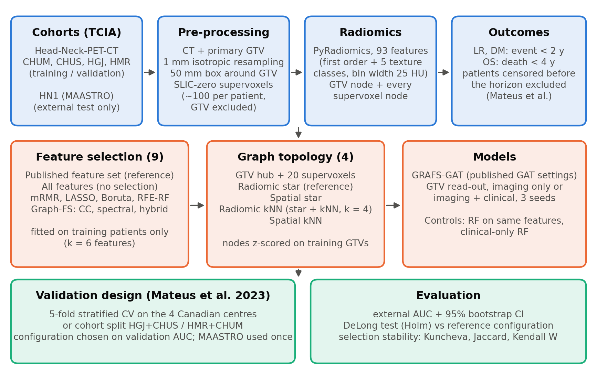
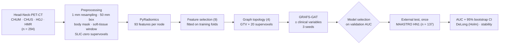
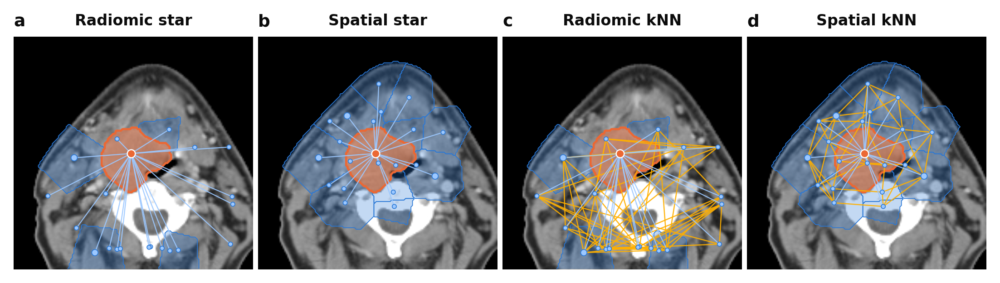
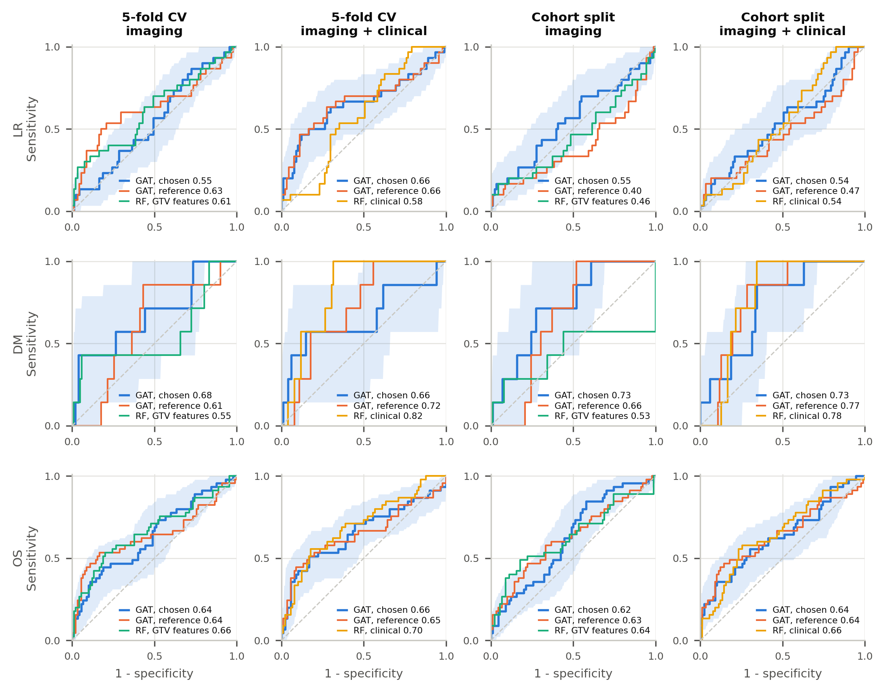
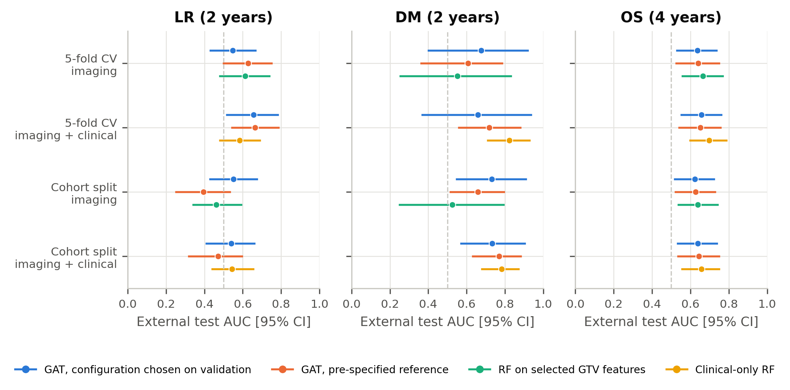
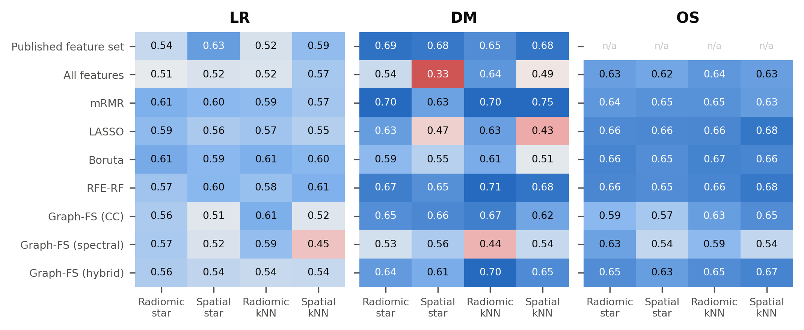
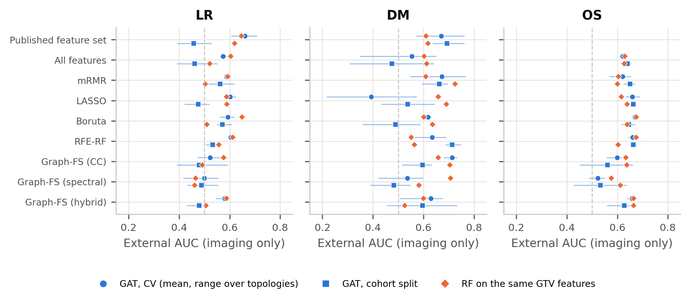
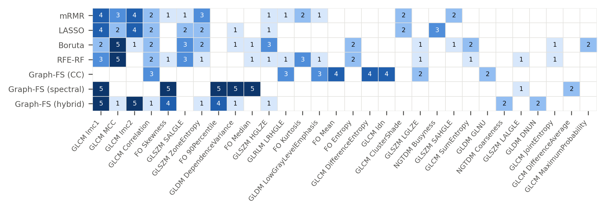
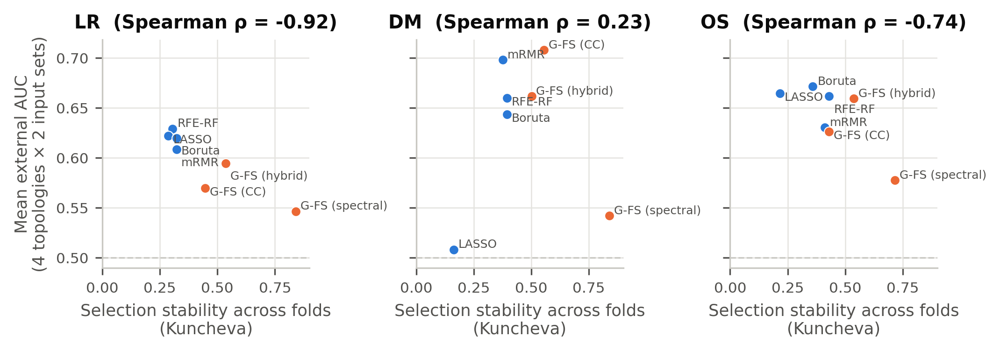
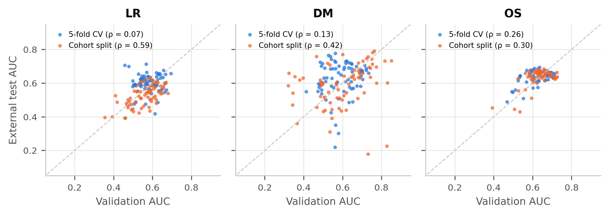

<div align="center">

# GRAFS-GAT: Graph Feature Selection with Graph Attention Networks for Head and Neck Cancer

**Reproducibility and external validity of graph-based feature selection in radiomic graph attention networks for outcome prediction in head and neck cancer**

[](https://www.python.org/)
[](https://pytorch.org/)
[](https://pytorch-geometric.readthedocs.io/)
[](https://pyradiomics.readthedocs.io/)
[](#13-reporting-and-reproducibility)
[](LICENSE)
[](#16-citation)

QIRAIL Lab · Department of Radiation Oncology · Christian Medical College (CMC) Vellore, India

</div>

---

## Contents

1. [Summary](#1-summary)
2. [Background and motivation](#2-background-and-motivation)
3. [Key concepts](#3-key-concepts)
4. [Study design](#4-study-design)
5. [Model architecture](#5-model-architecture)
6. [Methods](#6-methods)
7. [Results](#7-results)
8. [Discussion: what the results mean](#8-discussion-what-the-results-mean)
9. [Repository structure](#9-repository-structure)
10. [Installation](#10-installation)
11. [Data](#11-data)
12. [Reproducing the study](#12-reproducing-the-study)
13. [Reporting and reproducibility](#13-reporting-and-reproducibility)
14. [Inference and outputs](#14-inference-and-outputs)
15. [Limitations](#15-limitations)
16. [Citation](#16-citation)
17. [Acknowledgements and references](#17-acknowledgements-and-references)
18. [Keywords and topics](#18-keywords-and-topics)
19. [License](#19-license)

---

## 1. Summary

This project predicts three outcomes after radiotherapy for **head and neck squamous cell carcinoma (HNSCC)** from the pretreatment CT:

| Endpoint | Definition |
|---|---|
| **LR**: locoregional recurrence | event within 2 years |
| **DM**: distant metastasis | event within 2 years |
| **OS**: overall survival | death from any cause within 4 years |

**GRAFS-GAT** (GRAph Feature Selection + Graph ATtention network) turns each patient's tumour and the tissue around it into a **graph**, chooses the radiomic features of its nodes by **graph-based feature selection**, and lets a **graph attention network (GAT)** learn from it. It is benchmarked against the published CNN of Mateus et al. (2023) on the same public patients. The study tests two design questions that earlier work fixed by hand:

1. **Which radiomic features should describe the graph nodes?** Nine feature-selection strategies are compared, including the graph-based method *Graph-FS* and a new *hybrid* variant.
2. **How should the nodes be connected?** Four graph topologies are compared.

Every combination is judged on **how well it predicts** on an independent hospital it never saw (external validation) and on **how reproducible its selected features are**.

**Main findings, in one paragraph.** On the complete public cohorts (298 Canadian development patients, 137 external MAASTRO patients), graph-based feature selection made the selected features **much more reproducible**: the Kuncheva index across CV folds was 0.71–0.84 for spectral Graph-FS against 0.16–0.29 for LASSO. More reproducible features did **not** predict better; across selectors, stability was *inversely* related to external AUC (Spearman ρ = −0.92 for LR). The configurations chosen on validation reached external AUCs of **0.54–0.66 for locoregional recurrence, 0.66–0.73 for distant metastasis and 0.62–0.66 for overall survival**, and none was significantly better than the pre-specified reference configuration. The GAT matched a published CNN on the same external patients for LR and OS but not for DM, where a **clinical-only model was best (AUC 0.82)**, and a random forest on the tumour features alone did as well as the graph network. Finally, **validation AUC was a poor guide to which models would generalise** (Spearman ρ 0.07–0.59). This lesson applies to any study that compares many models on small cohorts.

---

## 2. Background and motivation

### The clinical problem
HNSCC is one of the ten most common cancers worldwide. Most patients with locally advanced disease are treated with radiotherapy, often with concurrent chemotherapy. Patients with the same stage, subsite and treatment still have very different outcomes. Some relapse within months, others are cured. A reliable **pre-treatment risk estimate** could guide treatment intensification for high-risk patients, de-escalation for low-risk patients, and individualised follow-up.

### Why radiomics, and why look beyond the tumour?
**Radiomics** extracts hundreds of quantitative descriptors (intensity, texture, heterogeneity) from routine medical images. Two problems recur in the radiomics literature:

* **The surroundings are ignored.** Most models summarise the tumour as one region. Locoregional and nodal spread, however, happen *through the tissue around the tumour*.
* **Results are hard to reproduce.**
  - Radiomic features depend on the scanner and on processing.
  - The features a selection algorithm picks change when the training data change slightly.
  - Published deep learning models often cannot be retrained to the performance their authors reported.

### Three studies this project builds on

| Study | What it contributed | What it left open |
|---|---|---|
| **Spatial radiomic graphs** (Bae et al., 2025) | Represents each patient as a graph: the tumour (GTV) is the central node and peritumoral **supervoxels** are surrounding nodes. A GAT gathers information from the surroundings into the tumour node. | The node features were a small **fixed** set, and the graph wiring (the "radiomic star") was **fixed**. Neither choice was tested, and the reproducibility of the features was unknown. |
| **Graph-FS** (Moradmand et al., 2025) | Feature selection on a **graph of features**: correlated features form communities, and one representative is kept per community. Much more stable than LASSO, Boruta, RFE or mRMR. | Never combined with graph neural networks, and never tested for externally validated outcome prediction. |
| **Mateus et al.** (2023) | A **reproducible validation protocol** on public data (Canadian centres → Dutch cohort). It showed that reported performance depends strongly on the validation design and on how the training checkpoint is chosen. | Gives a published CNN benchmark on exactly the same external patients. |

### What this project adds
* Combines Graph-FS with a spatial radiomic GAT for the first time.
* Introduces a **hybrid Graph-FS** that balances reproducibility and predictive power.
* Tests the **graph topology** as well as the features.
* Uses a strict **external validation** protocol with a direct comparison to a published CNN.
* Releases code, trained models and the scripts that regenerate every table and figure.

---

## 3. Key concepts

<details>
<summary><b>Click to expand a short glossary (useful if you are new to radiomics or graph neural networks)</b></summary>

| Term | Meaning in this project |
|---|---|
| **GTV** (gross tumour volume) | The primary tumour as outlined by the radiation oncologist on CT. It is the central node of every patient graph. |
| **Supervoxel** | A small 3-D region of neighbouring voxels with similar intensity, produced by the SLIC algorithm. It plays the role of a "super-pixel" in 3-D. The peritumoral tissue is split into about 100 supervoxels and 20 of them become graph nodes. |
| **Radiomic feature** | A number that describes the intensity or texture of a region, for example GLCM contrast or first-order skewness. 93 features are computed per node. |
| **Feature selection** | Choosing a small subset (here 6) of the 93 features, so that the model is not overwhelmed by redundant or noisy inputs. |
| **Graph-FS** | A feature-selection method that builds a graph whose nodes are *features* (not patients). Strongly correlated features are linked, and one representative is kept per group of redundant features. |
| **Graph topology** | The rule that decides which nodes of a patient graph are connected by edges. |
| **GAT** (graph attention network) | A neural network for graphs. Each node updates its representation by combining its neighbours' features, weighted by learned **attention** scores. |
| **Read-out** | The node whose final representation is used for prediction. Here it is the GTV node. |
| **AUC** | Area under the ROC curve: the probability that the model ranks a random patient with the event above a random patient without it. 0.5 = chance, 1.0 = perfect. |
| **External validation** | Testing on patients from a different hospital that were never used for training or model choice. This is the most honest estimate of real-world performance. |
| **Data leakage** | When information from validation or test patients slips into training, for example by selecting features on all patients. Leakage inflates results. This pipeline fits every data-dependent step on training patients only. |
| **Kuncheva index** | A measure of how similar two selected feature sets are, corrected for chance. 1 = identical, 0 = chance agreement. It is used to measure **reproducibility**. |
| **DeLong test** | A statistical test comparing the AUCs of two models on the same patients. |
| **Holm correction** | An adjustment of *p*-values when many comparisons are made, so that "significant" findings are not just luck. |
| **Bootstrap CI** | A confidence interval computed by resampling patients 1000 times. |

</details>

---

## 4. Study design

<p align="center">
  
</p>



### Cohorts
* **Development:** the public **Head-Neck-PET-CT** collection (TCIA) from four hospitals in Québec, Canada: CHUM, CHUS, HGJ and HMR. All 298 patients are used (CT of the pretreatment PET/CT with its radiotherapy structure set); 294 have enough follow-up for at least one endpoint.
* **External test:** the public **HN1** collection from MAASTRO Clinic, the Netherlands (137 patients). These patients were **never** used for feature selection, scaling, training or model choice. They were evaluated exactly once.

### Endpoints
These follow Mateus et al.:

* LR and DM: an event **within 2 years** of diagnosis.
* OS: death from any cause **within 4 years**, the median follow-up of the development data.

Patients without an event who were followed for less than the horizon are excluded, because their outcome is unknown. Events after the horizon count as negative.

### Two development designs
The study uses two development designs, because Mateus et al. showed that results depend on the validation design:

| Design (`--mode`) | How the Canadian patients are split | Why |
|---|---|---|
| `MATEUS_CV` (primary) | **5-fold cross-validation** stratified by outcome. The *entire* pipeline (feature selection → scaling → training) is refitted in every fold. External predictions are averaged over the 5 fold models. | Uses all development patients for both training and validation. Every patient is validated exactly once. |
| `MATEUS_COHORT` | **Centre split** (Diamant et al., 2019): train on **HGJ + CHUS**, validate on **HMR + CHUM**. | The validation set comes from different hospitals, so model choice already rewards transfer between centres. |

In both designs, the configuration with the best **validation** AUC is chosen and then tested once on MAASTRO.

### The experimental grid

| Factor | Levels |
|---|---|
| Endpoints | 3 (LR, DM, OS) |
| Feature-selection strategies | 9 (8 for OS, which has no reference set) |
| Graph topologies | 4 |
| Input sets | 2 (imaging only; imaging + clinical) |
| Development designs | 2 (5-fold CV; cohort split) |
| Random seeds per configuration | 3 (predictions averaged) |
| Checkpoint rules | 2 (lowest validation loss = primary; Mateus AUC-gap rule = sensitivity analysis) |

This gives 144 GAT configurations per endpoint for LR and DM and 128 for OS, each trained with 3 seeds (and in each of the 5 CV folds).

---

## 5. Model architecture

<p align="center">
  
</p>

### How the model works
1. **Build the graph (left panel).** The patient's GTV becomes the central node (star). 20 peritumoral supervoxels become surrounding nodes. Each node carries the 6 selected radiomic features, and the edges follow the chosen topology.
2. **Message passing.** In each GAT layer, every node collects its neighbours' features. It does not simply average them: it learns **attention weights** that say how much each neighbour should count.
3. **Multi-head attention (right panel).** At each layer, 4 independent attention "heads" do this in parallel and their results are concatenated, followed by layer normalisation and ReLU. Several heads make learning more stable and let the network attend to different patterns at once.
4. **Read-out.** After the last layer, only the **GTV node's** representation (16 numbers) is kept. By then it summarises the tumour *and* what it learned from its surroundings.
5. **Optional clinical fusion.** The GTV embedding can be joined with 16 encoded clinical variables (age, sex, HPV, T and N stage, subsite, chemotherapy).
6. **Prediction.** A linear layer and a sigmoid give the probability of the event.

### Hyper-parameters
The hyper-parameters are taken from Bae et al. (2025) and were not tuned here, so that the comparison isolates the effect of features and topology:

| Hyper-parameter | LR / OS | DM |
|---|---|---|
| GAT layers | 4 multi-head + 1 single-head output layer | 3 |
| Heads × units per head | 4 × 16 | 4 × 8 |
| Normalisation / activation | graph-wise LayerNorm + ReLU | graph-wise LayerNorm + ReLU |
| Read-out | GTV node embedding (16-d) → dropout → [⊕ clinical] → linear → sigmoid | same, stronger dropout |
| Trainable parameters (with clinical inputs) | 15,057 | 1,841 |
| Loss / class balancing | BCE, per-epoch resampling of both classes to the mean class size | BCE, minority oversampling |
| Optimiser | Adam + linear warm-up, ReduceLROnPlateau, gradient clipping, early stopping (patience 50) | same |
| Checkpoint kept | lowest validation loss (Bae et al. 2025); Mateus AUC-gap rule as a sensitivity analysis | same |

The networks are deliberately **small**: about 15k parameters for LR and fewer than 2k for DM. With only 27–44 events in the development data, a larger network would simply memorise the training patients.

---

## 6. Methods

### 6.1 Image preprocessing and radiomic features

| Step | What is done | Why |
|---|---|---|
| Resampling | CT to **1 mm isotropic** voxels (linear); GTV mask with nearest neighbour | Patients scanned with different slice thicknesses become comparable. |
| Peritumoral region | Crop a box extending **50 mm** beyond the GTV and remove the GTV voxels | Defines "the surroundings" in the same way as Bae et al. (2025). |
| Body mask + window | Region restricted to the patient body (CT > −500 HU, largest component, holes filled); CT clipped to −160…240 HU for SLIC only | Without them ~25% of supervoxels were mostly air and SLIC followed air/bone edges; with them 0% (preprocessing v4). |
| Supervoxels | **SLIC-zero** splits the region into ~100 supervoxels; those under 8 voxels are discarded | Splits the surroundings into anatomically coherent pieces that become graph nodes. |
| Radiomics | **93 PyRadiomics features** per node, bin width 25 HU: 18 first-order, 24 GLCM, 16 GLRLM, 16 GLSZM, 14 GLDM, 5 NGTDM | Standard, IBSI-aligned intensity and texture descriptors. **Shape** features are excluded because a supervoxel's shape reflects the algorithm, not the tissue. |

### 6.2 Feature selection: 9 strategies, k = 6 features each

Before selection, near-constant features are removed, heavy-tailed features (|skewness| > 2) are log-transformed, and all features are z-scored on the **training** patients. Every data-driven method keeps exactly **6 features**, so that differences come from *which* features are chosen, not *how many*.

| Strategy | Type | How it chooses features |
|---|---|---|
| `table_s3` | reference | The fixed published feature set (Bae et al. 2025, Table S3; 4 features for LR, 6 for DM). |
| `all` | reference | All 93 features, no selection. |
| `mrmr` | supervised | Greedily picks features with high relevance to the outcome (ANOVA F) and low redundancy with features already picked. Used as the OS reference. |
| `lasso` | supervised | L1-penalised logistic regression; features ranked by when they enter the regularisation path. |
| `boruta` | supervised | Keeps features whose random-forest importance beats randomly permuted "shadow" copies. |
| `rfe_rf` | supervised | Recursively removes the least important features of a random forest. |
| `graph_fs_cc` | label-free | **Graph-FS, connected components**: one representative (highest degree centrality) per group of correlated features. |
| `graph_fs_spectral` | label-free | **Graph-FS, spectral**: clusters the feature graph into k groups and keeps the feature closest to each cluster centre. |
| `graph_fs_hybrid` | hybrid (**new**) | Splits the feature graph into communities, takes the **most outcome-relevant** feature of each, and keeps the top 6. |

#### How Graph-FS works, and why the hybrid variant was introduced

<p align="center">
  
</p>

The figure shows the steps on real training data (fold 1, LR: 152 patients, 11 events):

* **(a)** The patients × features matrix.
* **(b)** Absolute correlation between every pair of features.
* **(c)** A pair of features is linked if their correlation exceeds *mean + 0.3 SD* (here 0.49), which gives 1,592 edges.
* **(d)** The resulting **feature graph**.
* **(e)** **Spectral Graph-FS** cuts the graph into 6 clusters and keeps the most central feature of each. Here 88 of 93 features fall in one huge cluster, so 5 of the 6 picks are "loner" features with unusual correlation patterns.
* **(f)** The **hybrid** variant cuts the graph into 17 communities, picks the most outcome-relevant feature in each, and keeps the 6 most relevant.

**Why the hybrid?** Label-free Graph-FS controls redundancy but **ignores the outcome**. It can therefore be perfectly reproducible and still predict nothing. The hybrid keeps the graph's redundancy control, so its selections stay stable, but lets the outcome decide *which* member of each community to keep, so the selected features stay relevant.

### 6.3 Graph topologies (GTV + 20 supervoxels)

<p align="center">
  
</p>

| Topology | Edges | Idea it tests |
|---|---|---|
| **(a)** `radiomic_star` (reference) | GTV ↔ the 20 supervoxels **most similar to it in feature space** | Tissue that "looks like" tumour matters, wherever it is. |
| **(b)** `spatial_star` | GTV ↔ the 20 supervoxels **nearest to it in physical space** | The immediate surroundings matter, which is how invasion actually spreads. |
| **(c)** `radiomic_knn` | radiomic star + edges between each node and its 4 nearest neighbours in feature space | Supervoxels can also exchange information with each other. |
| **(d)** `spatial_knn` | spatial star + edges between each node and its 4 nearest physical neighbours | The same, along anatomical neighbourhoods. |

In the radiomic star **(a)**, the connected supervoxels can lie far from the tumour. In the spatial star **(b)**, they hug it. Node features are z-scored with the training GTV statistics and clipped at ±5.

### 6.4 Comparators

These comparators are what make the conclusions about the GAT meaningful:

* **Reference GAT:** the pre-specified reference configuration (Table S3 features + radiomic star). For OS, which has no published set, mRMR + radiomic star. Every other configuration is tested **against this reference**.
* **Random forest on the same GTV features:** it sees the tumour but not the surroundings. If the GAT beats it, the **peritumoral graph** adds information.
* **Clinical-only random forest:** shows what can be achieved without any imaging.

### 6.5 Statistics
* **Discrimination:** AUC with a 95% percentile bootstrap CI (1000 resamples).
* **Comparisons:** paired **DeLong** tests against the reference and against the matching RF, with **Holm** correction across the configurations within each endpoint/design/input set.
* **Reproducibility:** **Kuncheva index** (also Jaccard and Kendall's W), measured in three settings:
  1. across the 5 CV folds;
  2. across 30 bootstrap resamples of the training data in each fold;
  3. between selections made separately in the two largest centres, CHUS and HGJ.
* **Associations:** Spearman's ρ (stability ↔ external AUC; validation AUC ↔ external AUC).

---

## 7. Results

All results below come from the complete Head-Neck-PET-CT collection (298 patients) with preprocessing v4 (body mask + soft-tissue window), run on 17–18 November 2026. Every number is regenerated from `grafs-gat/outputs/results/` by `make_paper_assets.py`.

### 7.1 Patient cohorts

| | Head-Neck-PET-CT (training / validation) | MAASTRO HN1 (external test) |
|---|---|---|
| Patients analysed | 294 | 137 |
| Age, median (IQR), y | 63 (57–71) | 61 (56–67) |
| Male sex | 224 (76%) | 111 (81%) |
| HPV positive / negative / unknown | 76 / 46 / 172 | 23 / 58 / 56 |
| Oropharynx / larynx / other | 201 / 43 / 50 | 88 / 49 / 0 |
| N2–N3 | 198 (67%) | 61 (45%) |
| Concurrent chemotherapy | 248 (84%) | 37 (27%) |
| **LR**, patients (events) | 276 (30, 10.9%) | 121 (30, 24.8%) |
| **DM**, patients (events) | 276 (27, 9.8%) | 109 (7, 6.4%) |
| **OS**, patients (events) | 164 (44, 26.8%) | 135 (45, 33.3%) |

**What this table tells us.** The patient and event counts match Table 1 of Mateus et al. exactly, so the comparison with their CNN is on the same patients. The two cohorts nevertheless differ:

* Laryngeal cancer is more than twice as common in MAASTRO (36% vs 15%).
* HPV-positive disease, advanced nodal stage and concurrent chemotherapy are much more common in Canada.
* The LR event rate is more than twice as high externally (24.8% vs 10.9%), whereas MAASTRO has only **7 DM events**.
* Events are scarce in the development data: 30 LR, 27 DM and 44 OS events, so each CV validation fold contains only about **6 LR or DM events**.

### 7.2 External performance: the main table

**How to read the table:**
* *Val. AUC* is the score used to **choose** the configuration.
* *Test AUC* is the honest external result on MAASTRO, with a 95% CI.
* *Reference* is the pre-specified reference configuration (mRMR + radiomic star for OS).
* *p* is the Holm-corrected DeLong test of the chosen GAT against the reference; *p* ≥ 0.05 means no significant difference.

| Endpoint | Design | Inputs | Chosen GAT (configuration) | Val. AUC | **Test AUC, chosen GAT** | Test AUC, reference GAT | Test AUC, RF | Test AUC, clinical-only RF | *p* |
|---|---|---|---|:-:|:-:|:-:|:-:|:-:|:-:|
| **LR** | 5-fold CV | Img | Graph-FS (hybrid) + spatial kNN | 0.66 | 0.55 [0.43, 0.67] | 0.63 [0.50, 0.75] | 0.61 [0.48, 0.74] | – | 1.00 |
| | 5-fold CV | Img+Clin | RFE-RF + spatial kNN | 0.69 | 0.66 [0.52, 0.78] | 0.66 [0.54, 0.79] | – | 0.58 [0.48, 0.69] | 1.00 |
| | Cohort split | Img | Graph-FS (spectral) + radiomic kNN | 0.64 | 0.55 [0.43, 0.67] | 0.40 [0.25, 0.53] | 0.46 [0.34, 0.59] | – | 1.00 |
| | Cohort split | Img+Clin | LASSO + spatial kNN | 0.68 | 0.54 [0.41, 0.66] | 0.47 [0.32, 0.60] | – | 0.54 [0.44, 0.66] | 1.00 |
| **DM** | 5-fold CV | Img | mRMR + radiomic kNN | 0.72 | 0.68 [0.40, 0.92] | 0.61 [0.36, 0.78] | 0.55 [0.25, 0.83] | – | 1.00 |
| | 5-fold CV | Img+Clin | LASSO + radiomic kNN | 0.73 | 0.66 [0.37, 0.94] | 0.72 [0.56, 0.88] | – | **0.82 [0.71, 0.93]** | 1.00 |
| | Cohort split | Img | Graph-FS (hybrid) + radiomic kNN | 0.82 | 0.73 [0.55, 0.91] | 0.66 [0.52, 0.79] | 0.53 [0.25, 0.79] | – | 1.00 |
| | Cohort split | Img+Clin | Graph-FS (hybrid) + radiomic kNN | 0.85 | 0.73 [0.57, 0.90] | 0.77 [0.63, 0.88] | – | 0.78 [0.68, 0.87] | 1.00 |
| **OS** | 5-fold CV | Img | All + radiomic kNN | 0.71 | 0.64 [0.53, 0.74] | 0.64 [0.53, 0.75] | 0.66 [0.56, 0.77] | – | 1.00 |
| | 5-fold CV | Img+Clin | Graph-FS (hybrid) + radiomic star | 0.71 | 0.66 [0.55, 0.76] | 0.65 [0.54, 0.76] | – | 0.70 [0.60, 0.79] | 1.00 |
| | Cohort split | Img | Graph-FS (spectral) + radiomic kNN | 0.72 | 0.62 [0.52, 0.72] | 0.63 [0.52, 0.73] | 0.64 [0.54, 0.74] | – | 1.00 |
| | Cohort split | Img+Clin | All + radiomic star | 0.73 | 0.64 [0.53, 0.74] | 0.64 [0.53, 0.75] | – | 0.66 [0.56, 0.75] | 1.00 |

<p align="center">
  
  <br><em>External ROC curves on MAASTRO. Rows: LR, DM, OS. Columns: design × inputs. The chosen GAT is shown with its 95% bootstrap band.</em>
</p>

#### What the main table shows

* **No configuration beat the pre-specified reference significantly** (all *p* = 1.00 for the chosen models). For LR and OS no configuration in the whole grid differed significantly from the reference; the 8 DM configurations that did were all **worse**.
* **Locoregional recurrence is barely predictable externally.** The chosen GATs reached 0.54–0.66 and every confidence interval includes or approaches 0.5. Across the 144 LR configurations the median was 0.58 (range 0.39–0.71).
* **Distant metastasis:** the chosen GATs reached 0.66–0.73, but with only 7 external events the intervals are very wide (e.g. 0.40–0.92). The strongest DM model was the **clinical-only** random forest (0.82 in CV, 0.78 in the cohort split), consistent with nodal stage driving distant spread.
* **Overall survival** gave the most consistent, if modest, signal: 0.62–0.66 for the chosen GATs and the reference alike, with 97% of all OS configurations above 0.5 (median 0.65).

<p align="center">
  
  <br><em>External AUC with 95% CI for every endpoint, design and input set. The dashed line marks chance (0.5).</em>
</p>

### 7.3 Comparison with a published CNN on the same external patients

Mateus et al. (2023) trained a convolutional neural network on the same collections, with the same two designs and endpoint definitions, and tested it on the same MAASTRO patients. Their predictions are not available, so the comparison is descriptive.

CV rows: mean AUC (range) over the 5 fold models. Cohort-split rows: AUC [95% CI].

| Endpoint | Design | Inputs | This study (GAT) | Mateus et al. CNN |
|---|---|---|:-:|:-:|
| LR (2 y) | 5-fold CV | Img | 0.54 (0.46–0.60) | 0.53 (0.48–0.59) |
| | 5-fold CV | Img+Clin | 0.62 (0.56–0.66) | 0.57 (0.53–0.60) |
| | Cohort split | Img | 0.55 [0.43, 0.67] | 0.45 [0.32, 0.57] |
| | Cohort split | Img+Clin | 0.54 [0.41, 0.66] | 0.59 [0.47, 0.70] |
| DM (2 y) | 5-fold CV | Img | 0.68 (0.64–0.77) | **0.83** (0.76–0.90) |
| | 5-fold CV | Img+Clin | 0.62 (0.44–0.69) | **0.88** (0.86–0.90) |
| | Cohort split | Img | 0.73 [0.55, 0.91] | **0.89** [0.79, 0.98] |
| | Cohort split | Img+Clin | 0.73 [0.57, 0.90] | **0.93** [0.86, 0.99] |
| OS (4 y) | 5-fold CV | Img | 0.63 (0.62–0.64) | 0.63 (0.57–0.72) |
| | 5-fold CV | Img+Clin | 0.65 (0.64–0.66) | 0.68 (0.63–0.71) |
| | Cohort split | Img | 0.62 [0.52, 0.72] | 0.67 [0.57, 0.77] |
| | Cohort split | Img+Clin | 0.64 [0.53, 0.74] | 0.69 [0.59, 0.79] |

**Interpretation.**

* **LR.** Both models are close to chance on MAASTRO. Since two very different methods fail in the same way on the same patients, the problem is more likely the **transfer of the LR signal between the cohorts** (subsite, chemotherapy, PET/CT vs planning CT, very different event rates) than either model.
* **OS.** The two approaches perform similarly.
* **DM.** The CNN is clearly better, and so is a clinical-only random forest. Distant failure is driven by nodal disease and by disease outside the 50 mm peritumoral box that the graph represents.

### 7.4 Does feature selection or topology matter?

<p align="center">
  
  <br><em>Mean external AUC for each feature-selection strategy (rows) × topology (columns), averaged over designs and input sets. Blue = above 0.5, red = below.</em>
</p>

**Feature selection.** The label-driven selectors (mRMR, Boruta, RFE-RF) gave the best LR and DM results; spectral Graph-FS and the unselected feature set the worst. For DM, mRMR, RFE-RF, the published feature set and the CC and hybrid Graph-FS reached 0.61–0.75.

**Topology had almost no effect.** Mean external AUC averaged over selectors, designs and inputs:

| Topology | LR | DM | OS |
|---|:-:|:-:|:-:|
| Radiomic star (reference) | 0.57 | 0.63 | 0.64 |
| Spatial star | 0.56 | 0.57 | 0.62 |
| Radiomic kNN | 0.57 | **0.64** | 0.64 |
| Spatial kNN | 0.55 | 0.60 | 0.64 |

For DM the radiomic topologies did slightly better than the spatial ones, but **no difference survived correction for multiple testing**.

**Clinical variables helped every endpoint.** Mean external AUC over the grid:

| | LR | DM | OS |
|---|:-:|:-:|:-:|
| Imaging only | 0.54 | 0.59 | 0.62 |
| Imaging + clinical | **0.59** | **0.62** | **0.65** |

### 7.5 Does the peritumoral graph add anything beyond the tumour?

Each GAT is compared with a random forest trained on **exactly the same GTV features**. The forest sees only the tumour, while the GAT also sees the surroundings.

| Endpoint | Design | GAT better than RF (feature sets) | Mean AUC, GAT | Mean AUC, RF | Significant (Holm) |
|---|---|:-:|:-:|:-:|:-:|
| LR | 5-fold CV | 3/9 | 0.58 | 0.59 | 0 |
| LR | Cohort split | 3/9 | 0.50 | 0.53 | 1 (RF better) |
| DM | 5-fold CV | 6/9 | 0.60 | 0.62 | 0 |
| DM | Cohort split | 3/9 | 0.58 | 0.63 | 0 |
| OS | 5-fold CV | 2/8 | 0.63 | 0.63 | 0 |
| OS | Cohort split | 5/8 | 0.62 | 0.63 | 0 |

<p align="center">
  
</p>

**Interpretation.** With the events available here, the peritumoral graph **added no measurable information**: the tumour-only forest was as good as, or slightly better than, the GAT for every endpoint.

### 7.6 Feature-selection stability: the reproducibility result

**How to read the table:** Kuncheva index; 1 = the same features are picked every time, 0 = no better than random. The best value in each column is in bold.

| Method | CV folds LR | CV folds DM | CV folds OS | Bootstrap LR | Bootstrap DM | Bootstrap OS | Centres LR | Centres DM | Centres OS |
|---|:-:|:-:|:-:|:-:|:-:|:-:|:-:|:-:|:-:|
| mRMR | 0.32 | 0.38 | 0.41 | 0.17 | 0.37 | 0.22 | 0.04 | 0.11 | 0.03 |
| LASSO | 0.29 | 0.16 | 0.22 | 0.16 | 0.17 | 0.14 | 0.04 | 0.10 | 0.05 |
| Boruta | 0.32 | 0.39 | 0.36 | 0.14 | 0.35 | 0.18 | 0.03 | 0.10 | −0.01 |
| RFE-RF | 0.31 | 0.39 | 0.43 | 0.12 | 0.33 | 0.14 | 0.02 | 0.07 | 0.03 |
| Graph-FS (CC) | 0.45 | 0.55 | 0.43 | 0.33 | 0.34 | 0.30 | 0.10 | 0.11 | 0.05 |
| **Graph-FS (spectral)** | **0.84** | **0.84** | **0.71** | **0.64** | **0.62** | **0.48** | **0.19** | **0.25** | **0.16** |
| Graph-FS (hybrid) | 0.54 | 0.50 | 0.54 | 0.27 | 0.39 | 0.27 | 0.12 | 0.12 | 0.07 |

<p align="center">
  
</p>

**What this shows.**

* **Graph-FS is clearly the most reproducible family.** Spectral Graph-FS was the most stable method for every endpoint in every setting (CV-fold index 0.84 for LR, against **0.29 for LASSO**).
* The **supervised selectors** were the least stable; LASSO picked an almost entirely different feature set in each fold for DM (0.16).
* **Selections made in different hospitals agreed poorly for every method** (at most 0.25).

**Why Graph-FS is so stable.** Radiomic texture features are highly inter-correlated. At the Graph-FS threshold, 87 of the 93 features form **one big community**. A few features with distinctive correlation patterns form their own small communities: first-order skewness, median and 90th percentile, GLCM informational measure of correlation and GLDM dependence variance. Spectral Graph-FS chose **exactly these five features in all five folds** for LR. LASSO, Boruta and RFE-RF instead picked a *different* member of the big correlated community in almost every fold.

<p align="center">
  
  <br><em>In how many of the 5 CV folds each feature was selected, by each strategy (LR). Graph-FS rows show solid, repeated choices; LASSO, Boruta and RFE rows are scattered.</em>
</p>

### 7.7 Stability does not mean better prediction

<p align="center">
  
</p>

Across selectors, stability was **inversely** related to external AUC: Spearman ρ = **−0.92 for LR** and −0.74 for OS (ρ = 0.23 for DM, which rests on only 7 external events). The most stable method, spectral Graph-FS, gave the lowest mean external AUC for OS and, together with the unselected features, for LR and DM. mRMR and RFE-RF (Kuncheva ≈ 0.31 for LR) were among the most predictive. The **hybrid Graph-FS** was intermediate on both axes.

### 7.8 Validation AUC is a poor guide to external AUC

<p align="center">
  
  <br><em>Each point is one GAT configuration. If validation were a good guide, the points would follow the diagonal.</em>
</p>

Across configurations, the correlation between validation AUC and external AUC was **ρ = 0.07 (LR), 0.13 (DM) and 0.26 (OS)** in cross-validation and 0.59, 0.42 and 0.30 in the cohort split. Two observations show how noisy validation was:

* The five fold models of the *same* chosen LR configuration had external AUCs ranging from **0.46 to 0.60**.
* The reference configuration scored a validation AUC of only **0.35** in the cohort split, yet reached **0.63** externally in CV.

**Why?** With about 6 events per validation fold, a single patient changes the validation AUC a lot. When more than 100 configurations are compared on such noisy numbers, the "best" one is close to a **random draw** from the upper part of the grid. This is why the **pre-specified reference sometimes beat the data-driven choice**.

### 7.9 Sensitivity analysis and attention

* **Checkpoint rule.** Replacing "lowest validation loss" with the Mateus AUC-gap rule changed the reference configuration's external AUC by a median of **0.01** (at most 0.04). The chosen configurations changed more, because the rule also changed which configuration ranked first. The overall conclusions were unaffected.
* **Attention is nearly uniform.** For 98% of supervoxels, the GTV node's attention stayed within **±2.9%** of the patient mean. It showed **no dependence on distance** from the tumour and no difference between patients with and without recurrence. For the example patient below, the values ranged from 0.047 to 0.048, against a uniform value of 0.048. At this sample size, the attention maps **cannot be interpreted as showing where the risk is**.

<p align="center">
  
  <br><em>Attention of the GTV read-out for an external patient with locoregional recurrence. (a) Supervoxels on the CT, shaded by attention. (b) The patient graph. The near-uniform shading is the finding.</em>
</p>

---

## 8. Discussion: what the results mean

**1. Graph-FS solves the reproducibility problem, but reproducibility is not prognostic value.** Graph-based selection gave far more reproducible node features than LASSO, Boruta and RFE-RF, confirming the original Graph-FS study in a different setting (perturbing the training patients rather than the extraction settings). But label-free Graph-FS keeps "distinctive" features because they are structurally isolated, *not* because they are prognostic, and here the most stable selections were among the **least** predictive (ρ = −0.92 for LR). Stability should be reported **alongside** external discrimination, never as a substitute for it.

**2. The hybrid Graph-FS is a reasonable compromise.** By keeping the graph's redundancy control and letting the outcome choose within each community, the hybrid was the second most stable selector for LR and OS and was close to the best selectors for DM and OS. The evidence is not definitive.

**3. At this sample size, the peritumoral graph adds nothing measurable.** Topology barely mattered, attention was nearly uniform, and a random forest on the tumour features alone did as well as the GAT. Bae et al. (2025) obtained informative attention maps and a benefit of the graph from more than 1,500 training patients; here there were 30 LR and 27 DM events.

**4. The LR signal does not transfer to MAASTRO, for either method.** The GAT and the published CNN are both near chance for LR on MAASTRO, while both find some signal for OS. The cohorts differ in subsite, treatment, imaging (CT of a PET/CT vs planning CT) and LR event rate; a locoregional risk model learned on one population need not transfer to the other.

**5. Validation-based model selection is unreliable on small cohorts.** This is the most important lesson for practice, and it applies beyond graph networks. When many models are compared on validation folds with a handful of events, the winner largely reflects noise. Studies like this should:

* **fix a reference configuration in advance** and report it next to any data-driven choice;
* report the **distribution** of external performance across the whole grid, not just the best result;
* test differences formally, **with correction for multiple comparisons**.

> **Note on an earlier analysis.** A first run (15 Nov 2026) used only the 199 oropharyngeal patients of the HECKTOR image release and preprocessing v3. It suggested an LR advantage over the CNN (0.71 vs 0.59) that **did not replicate** on the complete collection. That analysis is superseded; its models remain available as release `v0.1.0-models` for transparency.

---

## 9. Repository structure

```
.
├── README.md                          ← this file
├── LICENSE                            MIT
├── grafs-gat/                    ← study code (start here)
│   ├── main.py                        CLI for every pipeline stage
│   ├── run_mateus_study.sh            the full study: LR, DM, OS × both designs × both checkpoint rules
│   ├── export_results.py              study-level CSVs, ROC figures, final model copies
│   ├── predict.py                     inference with the saved models (cohort patients or new NIfTI)
│   ├── verify_release.py              reproduces the published external AUCs from the released models
│   ├── check_setup.py                 environment + data check (patient/event counts vs the paper)
│   ├── smoke_test.py                  every stage on synthetic data (installation test)
│   ├── tools/organize_data.py         arranges the TCIA downloads
│   ├── Makefile                       make smoke | check | verify | study | export | paper | docker
│   ├── environment.yml, requirements.txt, requirements-lock.txt, Dockerfile
│   ├── DATA.md, REPRODUCIBILITY.md    data instructions; reproduction levels and verification log
│   ├── README.md                      detailed pipeline documentation
│   └── grafsgat/
│       ├── config.py                  cohorts, designs, FS × topology grid, GAT hyper-parameters
│       ├── data/                      clinical labels, CT/GTV loading, preprocessing, SLIC, PyRadiomics, splits
│       ├── selection/                 9 selectors incl. Graph-FS; stability metrics
│       ├── graphs/                    4 topologies; PyG datasets; class-balanced sampler
│       ├── models/gat.py              GRAFS-GAT network
│       ├── engine/                    training, evaluation (+ attention), RF baselines
│       ├── experiments/               benchmark grid, cross-fold summary, export
│       ├── inference.py               checkpoint loading and ensemble prediction
│       ├── provenance.py              provenance.json for every run
│       ├── stats.py, utils.py         DeLong, Holm, bootstrap CI, seeding
│       └── viz/                       all figures and the HTML report
├── Paper/
│   ├── grafs-gat_manuscript/          GRAFS-GAT manuscript (LaTeX) + Supplementary Information
│   │   ├── main.tex, supplementary.tex, references.bib
│   │   ├── figures/, tables/          generated; numbers.tex holds every number quoted in the text
│   │   ├── figures/source/            hand-drawn architecture figure
│   │   └── scripts/make_paper_assets.py   regenerates all figures, tables and numbers from the results
│   ├── popgraph_manuscript/           population-graph manuscript (grafs-gat/popgraph)
│   │   ├── main.tex, supplementary.tex, title_page.tex, cover_letter.tex
│   │   ├── figures/, tables/, submission_figures/   figures and tables as submitted
│   │   ├── scripts/                   make_assets.py, make_checklists.py, make_report.py
│   │   ├── generated/                 raw output of the scripts (figures, tables, numbers.tex)
│   │   └── report/                    study report (Word, PDF)
│   └── presentations/                 figure sources, slides, poster and abstract
└── paper_workflow/                    study rationale, GAT explainer, implementation audit, supervoxel documentation
    └── archive_v1/                    original drafts and notes (May 2026)
```

For a gentle, illustrated introduction, read the documents in [`paper_workflow/`](paper_workflow/):

* `01`: study rationale, design and methods;
* `02`: graph attention networks explained;
* `03`: implementation history and audit;
* `04`: how the supervoxels are generated.

---

## 10. Installation

Tested on Ubuntu (Linux 5.15) with Python 3.8, CUDA 11.7 and an NVIDIA GPU. Everything also runs on CPU, but more slowly. Choose one of three environments:

```bash
git clone https://github.com/hash123shaikh/Radiomics_Graph_Attention_Network_HNC.git
cd Radiomics_Graph_Attention_Network_HNC/grafs-gat

# (a) conda, with the exact package versions of the published results
conda env create -f environment.yml && conda activate GNNvenv

# (b) pip, into any Python 3.8 environment
pip install numpy==1.24.3 "setuptools>=65" && pip install -r requirements-lock.txt

# (c) Docker, with no local Python needed
docker build -t grafs-gat .
```

Then test the installation **without any patient data**:

```bash
make smoke            # = python smoke_test.py: every pipeline stage on synthetic data, ~2 min on CPU
```

The main pinned versions are `torch 2.0.1`, `torch-geometric 2.3.1`, `pyradiomics 3.0.1`, `SimpleITK 2.2.1`, `scikit-learn 1.3.0` and `mrmr-selection 0.2.6`. `requirements-lock.txt` pins every package at the exact version of the environment that produced the results. `torch-scatter`, `torch-sparse` and `torch-cluster` are **not** required.

---

## 11. Data

Both cohorts are public. **No patient data are included in this repository.** Step-by-step instructions are in **[grafs-gat/DATA.md](grafs-gat/DATA.md)**.

| Cohort | Role | Source |
|---|---|---|
| Head-Neck-PET-CT (CHUM, CHUS, HGJ, HMR) | training / validation | [TCIA Head-Neck-PET-CT](https://doi.org/10.7937/K9/TCIA.2017.8oje5q00): full DICOM collection (CT of the PET/CT + RTSTRUCT are used), `INFOclinical_HN_Version2_30may2018.xlsx` and `INFO_GTVcontours_HN.xlsx` |
| MAASTRO HN1 | external test only | [TCIA HN1](https://doi.org/10.7937/tcia.2019.8kap372n): DICOM CT + RTSTRUCT and the clinical table |

```bash
# arrange the downloads (symlinks; the downloaded folders are not modified)
python tools/organize_data.py hnpet --src <NBIA download> --clinical <INFOclinical .xlsx> \
       --gtv-list <INFO_GTVcontours_HN.xlsx> --out data/Head-Neck-PET-CT
python tools/organize_data.py hn1   --src <NBIA download> --clinical <HN1 clinical .csv> --out data/MAASTRO

# check the data: compares your patient and event counts with Table 1 of the paper
make check
```

The data can live anywhere: set `GRAFS_DATA_DIR` (and `GRAFS_OUTPUT_DIR` for results). **No code needs to be edited.**

---

## 12. Reproducing the study

There are four levels of reproduction, from minutes to days. Details and the verification log are in **[grafs-gat/REPRODUCIBILITY.md](grafs-gat/REPRODUCIBILITY.md)**.

| Level | What it reproduces | Needs | Command (in `grafs-gat/`) |
|---|---|---|---|
| 0 | the installation works | nothing | `make smoke` |
| 1 | **the published external AUCs**, from the released models (`v1.0.0-models`) | MAASTRO data only | `make verify` |
| 2 | the full study, retrained from the raw images | both cohorts, GPU (several GPU-days) | `make study` |
| 3 | every figure, table and number of the manuscript | results of level 2 | `make export && make paper` |

**Current results (18 Nov 2026):** the full study was run on the complete Head-Neck-PET-CT collection with preprocessing v4; all **218 numbers**, tables and figures of the manuscript are regenerated from its results by `make paper`.

**Preprocessing profile.** The study uses **preprocessing v4** (body mask + soft-tissue window), the default everywhere. `make verify` downloads the released models (`v1.0.0-models`) and reproduces all 24 external AUCs (verified 18 Nov 2026: 24/24). The older **v3** profile is kept only to run the superseded release `v0.1.0-models` (first analysis on 199 patients; `make verify-v0`). Select the profile with `--preprocess v3|v4` or `GRAFS_PREPROCESS`. Caches record their profile, so files of different profiles are never mixed.

The pipeline runs as a series of stages. Each stage stores its output, so an interrupted run resumes where it stopped:

| Stage (`--stage`) | What it does | Output |
|---|---|---|
| `preprocess` | CT + primary GTV → 1 mm, 50 mm box, SLIC supervoxels | `outputs/cache/preprocessed/` |
| `extract` | 93 PyRadiomics features for the GTV and every supervoxel | `outputs/cache/features/` |
| `select` | every feature-selection method on the training split | `runs/<run>/selection/` |
| `stability` | bootstrap and cross-centre stability | `selection/stability_*.csv` |
| `benchmark` | graphs, GAT grid, RF baselines | `graphs/`, `models/`, `predictions/` |
| `summary` | seed-ensembled AUC + CI, DeLong/Holm, figures | `results_summary.csv`, `figures/`, `report.html` |

Use `--force` to recompute a stage. Examples:

```bash
python main.py --mode MATEUS_CV     --task DM --from_stage select                            # 5 folds + cross-fold summary
python main.py --mode MATEUS_CV     --task OS --from_stage select --fold 3                   # a single fold
python main.py --mode MATEUS_COHORT --task LR --from_stage select --epoch_rule auc_gap       # Mateus checkpoint rule
python main.py --mode MATEUS_CV     --task LR --stage benchmark \
               --methods graph_fs_spectral mrmr --topologies radiomic_star --seeds 42        # a subset of the grid
```

Every run writes a `provenance.json` with the git commit, command, package versions, device, preprocessing profile and settings, so each result can be traced to the code that produced it.

---

## 13. Reporting and reproducibility

* **Reporting guidelines:** TRIPOD (type 3, external validation) and CLAIM.
* **No data leakage:** feature selection, scaling, clinical encoding and model fitting use **training patients only**. Model choice uses validation only. MAASTRO is evaluated **once**.
* **Determinism:** fixed seeds (3 per configuration, probabilities averaged), saved data splits, cached stages, an exact package lock and a Docker image. GPU scatter operations are not bit-deterministic, so a retrained model can differ slightly; the released models remove this variation.
* **Provenance:** every run records the git commit, package versions, device and settings in `provenance.json`.
* **Traceable numbers:** every number, table and figure in the manuscript is generated by `make_paper_assets.py` from the result CSVs. Nothing is typed by hand.
* **Checkpoint fidelity:** re-applying the stored models reproduces the reported external predictions to within 10⁻⁷.
* **Honest comparison:** a pre-specified reference, results reported for the whole grid, and Holm-corrected tests.

---

## 14. Inference and outputs

Every saved checkpoint is **self-contained**. It stores the weights, hyper-parameters, selected features, training scaler, clinical encoder, decision threshold and topology, so no retraining is needed:

```bash
python predict.py --task LR --models <unzipped release>/final_models/MATEUS_CV_LR/imaging \
                  --dataset MAASTRO --preprocess v3                                  # released models, whole cohort
python predict.py --task OS --design MATEUS_COHORT --inputs imaging+clinical --dataset MAASTRO   # models of your own run
python predict.py --task DM --config mrmr__spatial_star --dataset MAASTRO --patients HN1004 HN1006
python predict.py --task LR --ct new/CT.nii.gz --mask new/GTV.nii.gz --id NEW001    # a new patient
```

For each patient the output gives the ensemble probability, the spread across ensemble members, high or low risk at the validation Youden threshold, and the label when it is known.

> **Trained models** are not tracked in git. The models of the manuscript (complete cohort, preprocessing v4; 24 ensembles, 216 checkpoints) are attached to the [GitHub release `v1.0.0-models`](https://github.com/hash123shaikh/Radiomics_Graph_Attention_Network_HNC/releases/tag/v1.0.0-models). `make verify` downloads them and checks every ensemble against its reported external AUC. To use them yourself, unzip `grafs-gat_final_models_v4.zip` and pass `--models .../final_models/<DESIGN>_<TASK>/<inputs>`. The earlier release [`v0.1.0-models`](https://github.com/hash123shaikh/Radiomics_Graph_Attention_Network_HNC/releases/tag/v0.1.0-models) holds the models of the superseded 199-patient analysis (preprocessing v3; `make verify-v0`, `--preprocess v3`).

| Result file (`grafs-gat/outputs/results/`) | Content |
|---|---|
| `main_results.csv` | for each endpoint × design × checkpoint rule × inputs: chosen GAT, reference GAT, best RF and clinical-only RF, with validation AUC, external AUC [95% CI], fold range and Holm-corrected DeLong *p* |
| `all_configurations.csv` | every configuration of every run |
| `feature_selection_stability.csv` | stability of every selector across CV folds, bootstrap resamples and centres |
| `cohort_summary.csv` | patients and events for each endpoint and cohort |
| `predictions/*.csv` | per-patient probabilities (out-of-fold validation + external test) |
| `figures/` | ROC curves, per-fold ROC curves, AUC overview |
| `runs/<MODE>_<TASK>/report.html` | self-contained HTML report of each run |

---

## 15. Limitations

* **Few events.** Even the complete Canadian collection contains only 30 LR, 27 DM and 44 OS events, far below common sample-size recommendations for prediction models.
* **DM external set.** With 7 external DM events, DM results cannot be interpreted beyond their confidence intervals.
* **Cohort shift.** The test cohort has more laryngeal cancers, more HPV-negative patients, less chemotherapy and a much higher LR event rate. Development CTs are the CT of a PET/CT; MAASTRO CTs are planning CTs.
* **One extraction setting.** Stability was measured across data resamples and centres, not across radiomic extraction settings as in the original Graph-FS study.
* **Supervoxel scale.** With 100 supervoxels in a 50 mm box, each supervoxel is about 20 cm³, twice the median GTV; finer supervoxels have not been tested.
* **Hyper-parameters** were taken from Bae et al. (2025), not tuned, and OS reused the LR settings.
* **Binary horizons** discard censored patients. A survival formulation could use the data more efficiently.
* **Fixed k = 6** for every selector, chosen for comparability. `--k native` lets each selector use its own size.

---

## 16. Citation

The manuscript is in preparation. Until it is published, please cite this repository:

```bibtex
@misc{shaikh_radgat_hnc,
  author       = {Shaikh, Hasan},
  title        = {Reproducibility and external validity of graph-based feature selection in radiomic
                  graph attention networks for outcome prediction in head and neck cancer},
  year         = {2026},
  howpublished = {\url{https://github.com/hash123shaikh/Radiomics_Graph_Attention_Network_HNC}},
  note         = {QIRAIL Lab, Department of Radiation Oncology, Christian Medical College Vellore}
}
```

---

## 17. Acknowledgements and references

This work builds on:

* **Spatial radiomic graphs:** Bae et al. Spatial radiomic graph with graph attention network for outcome prediction in head and neck cancer. *Radiology: Imaging Cancer*, 2025.
* **Graph-FS:** Moradmand et al. Graph-based feature selection for reproducible radiomics. *Scientific Reports* 15, 27995 (2025).
* **Validation design and CNN benchmark:** Mateus et al. *Scientific Reports* 13, 18176 (2023).
* **Cohort split:** Diamant et al. Deep learning in head & neck cancer outcome prediction. *Scientific Reports* 9, 2764 (2019).
* **Data:** Vallières et al., Head-Neck-PET-CT (TCIA, 2017); Wee & Dekker, HN1 (TCIA, 2019); Clark et al., The Cancer Imaging Archive (2013).
* **Methods:** Veličković et al., Graph Attention Networks (ICLR 2018); Achanta et al., SLIC superpixels (2012); van Griethuysen et al., PyRadiomics (2017); Kuncheva, stability index (2007); DeLong et al. (1988); Holm (1979).
* **Software:** PyTorch, PyTorch Geometric, PyRadiomics, scikit-learn, SimpleITK.

The original authors' code (Bae et al. 2025) is not redistributed here. Please obtain it from its authors.

---

## 18. Keywords and topics

**Keywords:** head and neck cancer · HNSCC · radiomics · graph neural network · graph attention network · feature selection · Graph-FS · reproducibility · external validation · radiotherapy outcome prediction · locoregional recurrence · distant metastasis · overall survival · supervoxels · SLIC · PyRadiomics · TCIA

**GitHub topics:** `radiomics` `graph-neural-networks` `graph-attention-network` `head-and-neck-cancer` `feature-selection` `medical-imaging` `pytorch-geometric` `pyradiomics` `outcome-prediction` `radiotherapy` `reproducibility` `deep-learning` `tcia` `external-validation`

---

## 19. License

The code is released under the [MIT License](LICENSE). The licence covers the code and documentation in this repository only. The imaging and clinical data stay under their TCIA licences, and the cited third-party works stay under their own terms.
