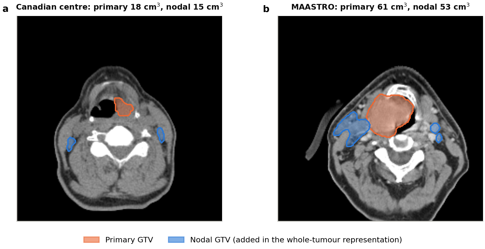
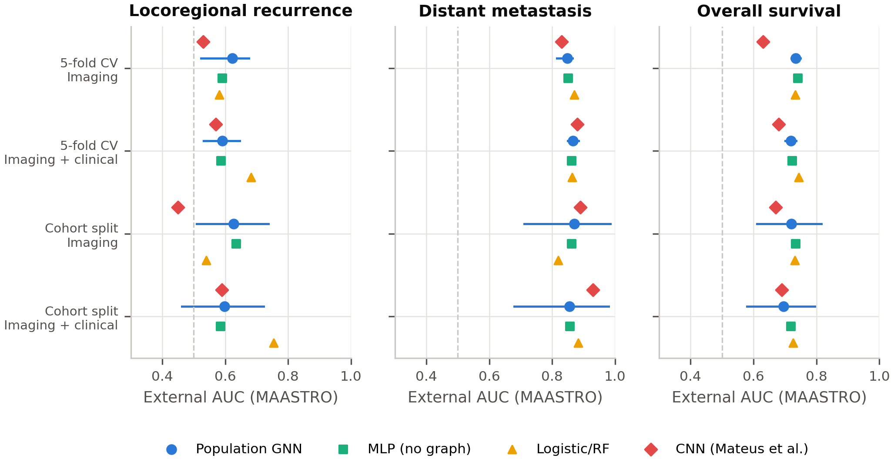
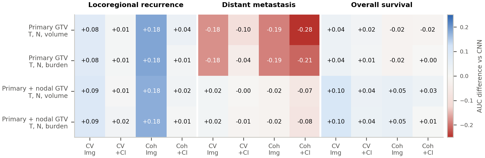
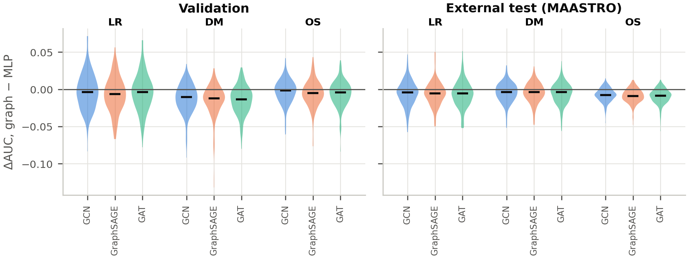
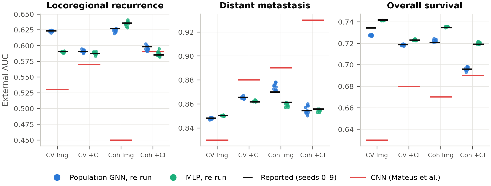

# Whole-tumour population graph analysis: report

*Population-graph study under the protocol of Mateus et al. Aggregate results only; generated by `Paper/popgraph_manuscript/scripts/make_report.py` from the manuscript tables.*

## Summary

This report summarises the population-graph analysis carried out on the protocol of Mateus et al., in which a published convolutional neural network (CNN) was retrained on the Canadian Head-Neck-PET-CT centres and tested on MAASTRO (HN1). Population graph neural networks (GCN, GraphSAGE and GAT; one node per patient, edges to the most similar training patients) were compared with the identical network without edges (MLP), with conventional classifiers and with the CNN, on radiomic features of the primary gross tumour volume (GTV) or of the whole tumour, that is, the union of the primary and nodal GTVs.

With whole-tumour features the graph networks chosen on validation reached external AUCs of 0.59–0.63 for locoregional recurrence (LR), 0.85–0.87 for distant metastasis (DM) and 0.70–0.73 for overall survival (OS), and exceeded the CNN in 9 of 12 endpoint–design–input settings, against 6 of 12 with primary-GTV features. The gain came from the tumour definition and not from tumour-burden clinical variables (9 and 9 of 12 with and without them). The patient graph added nothing: the MLP without edges exceeded the CNN in 8 of 12 settings, only 1 of 18 paired graph–MLP differences was nominally significant and it favoured the MLP, and with identical features the graph network was better on MAASTRO in only 29% of 1944 matched comparisons. All remaining shortfalls against the CNN were for DM, for which MAASTRO contained only 7 events.

## Data and design

Development used 294 Canadian patients and external testing 137 MAASTRO patients, with the endpoints, horizons, exclusions and the two development designs (stratified 5-fold cross-validation and the HGJ+CHUS versus HMR+CHUM cohort split) of Mateus et al. After exclusions MAASTRO contributed 121 patients with 30 LR events, 109 with 7 DM events and 135 with 45 deaths. Whole-tumour features (479 per patient: shape, original and Laplacian-of-Gaussian first-order and texture features) were extracted with PyRadiomics after 1 mm resampling. The grid crossed two feature sets, three selectors, three subset sizes, three neighbourhood sizes and the four networks, every configuration was a ten-seed ensemble, and the configuration with the highest validation AUC was chosen separately for the graph networks and for the MLP; MAASTRO labels were never used for training or choosing.

Nodal GTVs were delineated separately in 37% of Canadian but 59% of MAASTRO patients. In one Canadian centre (HGJ) separate nodal GTVs existed for only 12% of patients although 89% were node positive, and its primary GTVs were the largest, which suggests that nodes were included in the structure designated as the primary tumour. The whole-tumour definition describes the same anatomy in both cohorts.

**Table 1. Patient characteristics, tumour delineation and outcome cohorts (ᵃ CHUM, CHUS, HGJ, HMR; ᵇ external test; ᶜ patients with a nodal GTV; ᵈ patients eligible per endpoint).**

| Characteristic | Canadian centresᵃ training / validation | MAASTRO (HN1)ᵇ external test |
|---|---|---|
| Patients analysed | 294 | 137 |
| Age, median (IQR), y | 63 (57–71) | 61 (56–67) |
| Male sex | 224 (76%) | 111 (81%) |
| HPV positive | 76 (26%) | 23 (17%) |
| HPV negative | 46 (16%) | 58 (42%) |
| HPV unknown | 172 (59%) | 56 (41%) |
| Oropharynx | 201 (68%) | 88 (64%) |
| Larynx | 43 (15%) | 49 (36%) |
| Other subsite | 50 (17%) | 0 (0%) |
| T3–T4 | 139 (47%) | 70 (51%) |
| N2–N3 | 198 (67%) | 61 (45%) |
| Concurrent chemotherapy | 248 (84%) | 37 (27%) |
| Tumour delineation |  |  |
| Separate nodal GTV delineated | 110 (37%) | 81 (59%) |
| Primary GTV, median (IQR), cm³ | 23.8 (12.0–40.8) | 14.1 (3.7–33.7) |
| Nodal GTVᶜ, median (IQR), cm³ | 15.7 (6.1–34.7) | 10.5 (4.9–26.4) |
| Whole tumour, median (IQR), cm³ | 31.3 (16.4–54.0) | 20.1 (6.6–52.1) |
| Nodal share of whole tumourᶜ, median | 44% | 30% |
| Outcome cohortsᵈ |  |  |
| LR, patients (events, rate) | 276 (30, 10.9%) | 121 (30, 24.8%) |
| DM, patients (events, rate) | 276 (27, 9.8%) | 109 (7, 6.4%) |
| OS, patients (events, rate) | 164 (44, 26.8%) | 135 (45, 33.3%) |

## External discrimination

Table 2 compares the chosen models with the CNN. For LR and OS the graph networks exceeded the CNN in all four settings. For DM they exceeded it in cross-validation with imaging only (0.85 versus 0.83), were within 0.02 in two settings, and remained below it in the cohort split with clinical data (0.85, 95% CI 0.68–0.98, versus 0.93). A graph network on clinical variables alone reached 0.51–0.57 for LR, 0.79–0.81 for DM and 0.69–0.70 for OS.

**Table 2. External AUC on MAASTRO of the whole-tumour models chosen on validation versus the CNN (CV: mean (range) of per-fold AUCs; cohort split: AUC [95% CI]). ᵃ Mateus et al.; ᵇ whole tumour with tumour-burden variables; ᶜ logistic regression or random forest on the same features.**

| Design | Inputs | CNNᵃ AUC | Population GNNᵇ Model | AUC | MLP, no graphᵇ AUC | Logistic/RFᶜ AUC |
|---|---|---|---|---|---|---|
| Locoregional recurrence |  |  |  |  |  |  |
| 5-fold CV | Imaging | 0.53 | GAT | 0.62 (0.52–0.68) | 0.59 (0.55–0.62) | 0.58 (0.56–0.62) |
|  | Imaging + clinical | 0.57 | GraphSAGE | 0.59 (0.53–0.65) | 0.59 (0.50–0.64) | 0.68 (0.62–0.73) |
| Cohort split | Imaging | 0.45 | GCN | 0.63 [0.51, 0.74] | 0.64 [0.52, 0.75] | 0.54 [0.41, 0.67] |
|  | Imaging + clinical | 0.59 | GCN | 0.60 [0.46, 0.72] | 0.58 [0.45, 0.71] | 0.75 [0.66, 0.84] |
| Distant metastasis |  |  |  |  |  |  |
| 5-fold CV | Imaging | 0.83 | GCN | 0.85 (0.82–0.86) | 0.85 (0.81–0.87) | 0.87 (0.84–0.89) |
|  | Imaging + clinical | 0.88 | GraphSAGE | 0.87 (0.85–0.88) | 0.86 (0.85–0.88) | 0.86 (0.83–0.89) |
| Cohort split | Imaging | 0.89 | GraphSAGE | 0.87 [0.71, 0.99] | 0.86 [0.70, 0.99] | 0.82 [0.63, 0.98] |
|  | Imaging + clinical | 0.93 | GCN | 0.85 [0.68, 0.98] | 0.86 [0.71, 0.97] | 0.88 [0.74, 0.99] |
| Overall survival |  |  |  |  |  |  |
| 5-fold CV | Imaging | 0.63 | GCN | 0.73 (0.72–0.75) | 0.74 (0.74–0.75) | 0.73 (0.72–0.74) |
|  | Imaging + clinical | 0.68 | GCN | 0.72 (0.70–0.74) | 0.72 (0.71–0.73) | 0.74 (0.74–0.75) |
| Cohort split | Imaging | 0.67 | GraphSAGE | 0.72 [0.61, 0.82] | 0.73 [0.63, 0.83] | 0.73 [0.63, 0.82] |
|  | Imaging + clinical | 0.69 | GraphSAGE | 0.70 [0.58, 0.80] | 0.72 [0.61, 0.81] | 0.73 [0.62, 0.82] |

## Tumour definition versus tumour burden

Table 3 shows the 2×2 ablation. Replacing primary-GTV by whole-tumour features raised the DM AUC from 0.65–0.78 to 0.85–0.88 and the OS AUC from 0.65–0.70 to 0.72–0.73, and left LR unchanged. Tumour-burden clinical variables helped the primary-GTV models for DM but added nothing once the nodes were part of the radiomic region.

**Table 3. Representation ablation (external AUC of the chosen graph network; columns: LR, DM, OS × CV/cohort × imaging/+clinical).**

| Region | Clin. | LR CV Img | LR CV +Cl | LR Coh Img | LR Coh +Cl | DM CV Img | DM CV +Cl | DM Coh Img | DM Coh +Cl | OS CV Img | OS CV +Cl | OS Coh Img | OS Coh +Cl | Wins |
|---|---|---|---|---|---|---|---|---|---|---|---|---|---|---|
| CNN | – | 0.53 | 0.57 | 0.45 | 0.59 | 0.83 | 0.88 | 0.89 | 0.93 | 0.63 | 0.68 | 0.67 | 0.69 | – |
| Primary | Vol. | 0.61 | 0.58 | 0.63 | 0.63 | 0.65 | 0.78 | 0.70 | 0.65 | 0.67 | 0.70 | 0.65 | 0.67 | 6/12 |
| Primary | Burden | 0.61 | 0.58 | 0.63 | 0.60 | 0.65 | 0.84 | 0.70 | 0.72 | 0.67 | 0.69 | 0.65 | 0.69 | 7/12 |
| Whole tumour | Vol. | 0.62 | 0.58 | 0.63 | 0.61 | 0.85 | 0.88 | 0.87 | 0.86 | 0.73 | 0.72 | 0.72 | 0.72 | 9/12 |
| Whole tumour | Burden | 0.62 | 0.59 | 0.63 | 0.60 | 0.85 | 0.87 | 0.87 | 0.85 | 0.73 | 0.72 | 0.72 | 0.70 | 9/12 |

## Does the graph help?

Table 4 compares the chosen graph network with the chosen MLP on the same MAASTRO patients. The differences ranged from −0.023 to +0.050 AUC and only one reached nominal significance (p = 0.03), in favour of the MLP. Across all 1944 graph configurations, each compared with the MLP on identical features, the graph network had the higher validation AUC in 34% and the higher external AUC in 29% (median difference −0.006).

**Table 4. Chosen graph network versus chosen MLP on MAASTRO (paired bootstrap).**

| Design | Inputs | Graph model | Graph AUC | MLP AUC | ΔAUC [95% CI] | p |
|---|---|---|---|---|---|---|
| Locoregional recurrence |  |  |  |  |  |  |
| 5-fold CV | Imaging | GAT | 0.666 | 0.616 | +0.050 [−0.050, +0.150] | 0.38 |
|  | Imaging + clinical | GraphSAGE | 0.615 | 0.605 | +0.010 [−0.041, +0.066] | 0.72 |
|  | Clinical | GCN | 0.576 | 0.570 | +0.006 [−0.019, +0.032] | 0.65 |
| Cohort split | Imaging | GCN | 0.627 | 0.636 | −0.009 [−0.045, +0.027] | 0.63 |
|  | Imaging + clinical | GCN | 0.598 | 0.585 | +0.013 [−0.024, +0.053] | 0.52 |
|  | Clinical | GAT | 0.507 | 0.478 | +0.029 [−0.011, +0.069] | 0.17 |
| Distant metastasis |  |  |  |  |  |  |
| 5-fold CV | Imaging | GCN | 0.882 | 0.878 | +0.004 [−0.009, +0.022] | 0.72 |
|  | Imaging + clinical | GraphSAGE | 0.867 | 0.873 | −0.006 [−0.028, +0.013] | 0.66 |
|  | Clinical | GAT | 0.829 | 0.843 | −0.014 [−0.051, +0.013] | 0.38 |
| Cohort split | Imaging | GraphSAGE | 0.870 | 0.861 | +0.008 [−0.014, +0.033] | 0.51 |
|  | Imaging + clinical | GCN | 0.854 | 0.856 | −0.001 [−0.031, +0.031] | 0.91 |
|  | Clinical | GCN | 0.793 | 0.814 | −0.021 [−0.063, +0.012] | 0.28 |
| Overall survival |  |  |  |  |  |  |
| 5-fold CV | Imaging | GCN | 0.741 | 0.744 | −0.004 [−0.018, +0.011] | 0.64 |
|  | Imaging + clinical | GCN | 0.720 | 0.723 | −0.003 [−0.017, +0.012] | 0.72 |
|  | Clinical | GAT | 0.692 | 0.715 | −0.023 [−0.047, −0.001] | 0.03 |
| Cohort split | Imaging | GraphSAGE | 0.721 | 0.735 | −0.014 [−0.051, +0.021] | 0.38 |
|  | Imaging + clinical | GraphSAGE | 0.696 | 0.719 | −0.023 [−0.055, +0.005] | 0.13 |
|  | Clinical | GCN | 0.701 | 0.704 | −0.003 [−0.029, +0.023] | 0.79 |

## Training randomness and conventional classifiers

Retraining every chosen configuration with 10 disjoint ten-seed ensembles gave a median standard deviation of the external AUC of 0.001 (maximum 0.004); the graph network exceeded the CNN in every re-run in 9 of 12 settings and in none in 3. Conventional classifiers on the same whole-tumour features exceeded the CNN in 9 of 12 settings (LR 0.54–0.75, DM 0.82–0.88, OS 0.73–0.74). For LR, logistic regression on an extended clinical set alone (age, sex, HPV status, T, N, subsite, chemotherapy) reached 0.71–0.76 and outperformed every imaging model; the graph networks used the clinical variables of the CNN study (T, N, volume), which contain neither, so the CNN comparison does not show that imaging adds to a complete clinical model for LR.

## Interpretation and limitations

Radiomic models of the whole tumour match or exceed the published CNN for LR and OS and approach it for DM, and the improvement over the primary-GTV models is explained by the tumour definition, which captures nodal disease and harmonises inconsistent primary delineations, and not by the patient graph. The whole-tumour representation was introduced after the primary-GTV results were known, so MAASTRO was used more than once; this is mitigated by its a-priori motivation (the CNN sees the nodes), by validation-only model choice and by reporting the full ablation, but it should be confirmed on an independent cohort. The DM test set has only 7 events, the CNN comparison is descriptive because its predictions are unavailable, and nodal delineations in public collections are incomplete.
